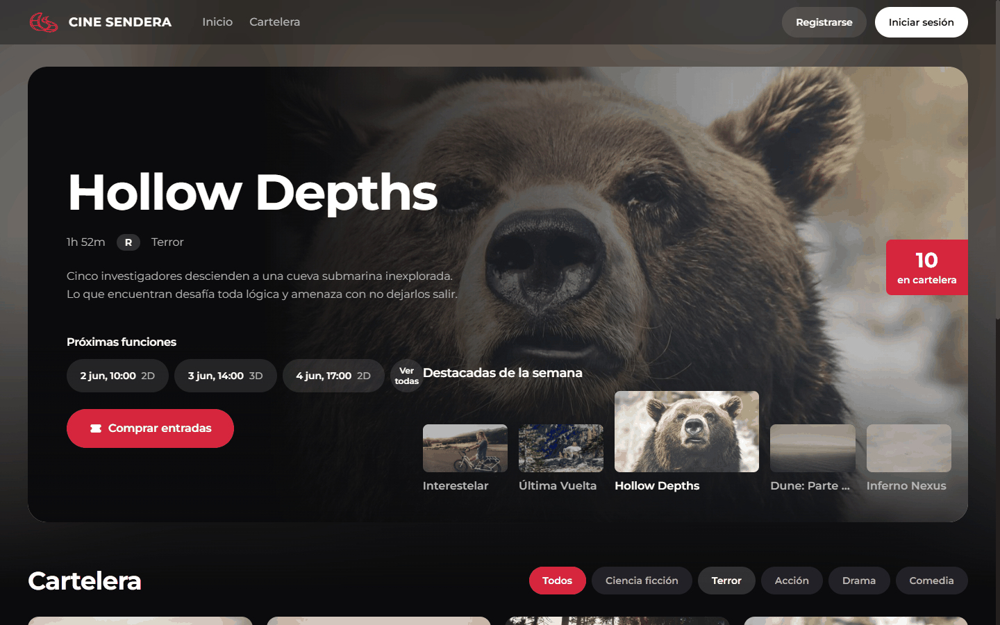
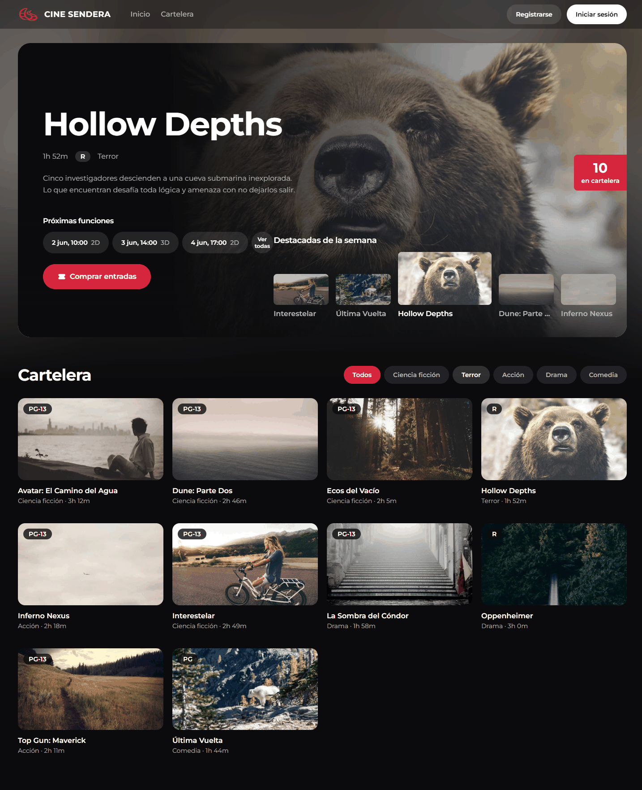
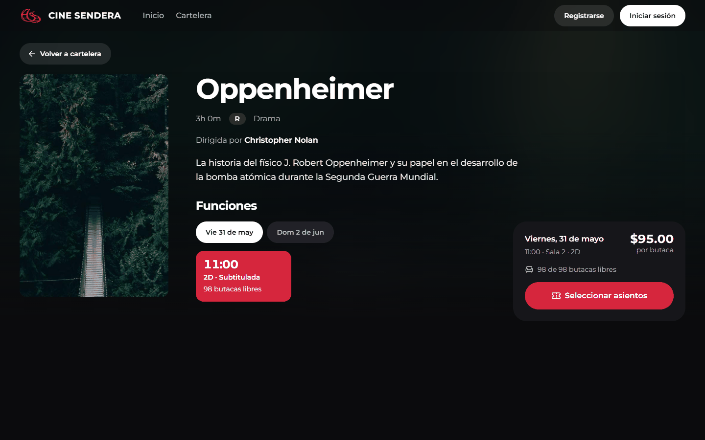
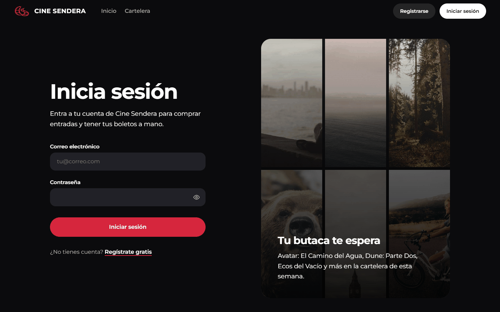
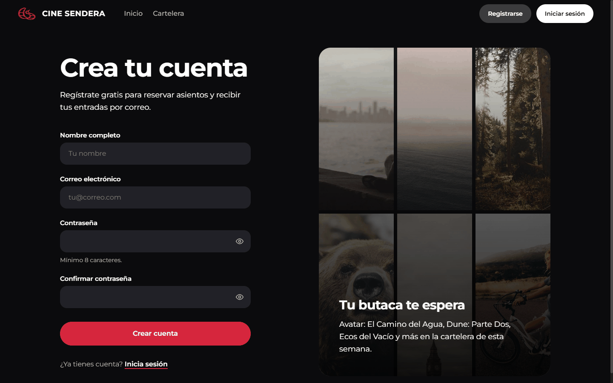
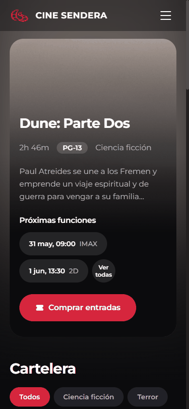

# Cine Sendera

> Sistema de gestión de cine: cartelera, venta de boletos con selección de asientos y panel de administración.

---

## Capturas de pantalla

Capturas del despliegue de demostración: https://jose-man.com/

### Inicio

Portada con la película destacada, sus próximas funciones, el acceso directo a la compra y el carrusel de destacadas de la semana.

### Cartelera

Listado de películas en cartelera con filtro por género; cada tarjeta muestra clasificación, género y duración.

### Detalle de película

Sinopsis, director y funciones agrupadas por día y horario, con precio por butaca y butacas libres de la función elegida.

### Inicio de sesión

Acceso con correo y contraseña. Es la puerta de entrada obligatoria para seleccionar asientos y comprar.

### Registro

Creación de cuenta de cliente con nombre, correo y contraseña.

### Inicio en móvil

La interfaz es responsive; aquí la portada a 390 px de ancho con el menú colapsado.

### Vistas que requieren sesión

Las siguientes pantallas solo son accesibles con una cuenta y no aparecen en las capturas: selección de asientos, checkout, ticket, mis entradas, verificación de correo pendiente y panel de administración. Se describen en la [arquitectura del frontend](docs/frontend-architecture.md).

---

## Documentación

### Backend

- [Backend](backend/README.md): visión general y puesta en marcha de la API Laravel.
- [Arquitectura del backend](docs/backend-architecture.md): capas, servicios, repositorios y convenciones.
- [Endpoints de la API](docs/api-endpoints.md): referencia de rutas, parámetros y respuestas.

### Datos y reglas

- [Diseño de base de datos](docs/database-design.md): esquema, restricciones y fuente de verdad del modelo.
- [Reglas de negocio](docs/reglas-de-negocio.md): compras, asientos, roles y políticas del sistema.

### Frontend

- [Frontend](frontend/README.md): visión general y puesta en marcha de la SPA React.
- [Arquitectura del frontend](docs/frontend-architecture.md): estructura, rutas, estado y consumo de la API.
- [Sistema de diseño](docs/frontend-design-system.md): tokens, componentes y guías visuales.

### Infraestructura y despliegue

- [Entorno de desarrollo con Docker](docs/docker-entorno-desarrollo.md): contenedores, redes, variables y arranque local.
- [Despliegue en producción](docs/deployment-produccion.md): simulación de producción con Docker Compose.
- [Despliegue en servidor personal](docs/deployment-servidor-personal.md): preproducción en el servidor propio.
- [CI/CD](docs/ci-cd.md): flujos de integración y entrega continua.

### Módulos

- [Módulos del sistema](docs/modulos/README.md): documentación funcional por módulo.
