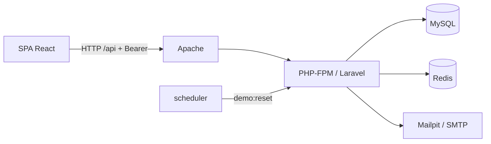

# Cine Sendera — Backend

API REST del sistema Cine Sendera: autenticación, cartelera, compra de boletos y panel de administración. Este directorio contiene el código Laravel; este archivo es el índice de la documentación del backend.

## Stack

| Componente    | Tecnología                                   |
| ------------- | -------------------------------------------- |
| Framework     | Laravel 13 sobre PHP 8.3+                    |
| Autenticación | Laravel Sanctum (Bearer token)               |
| Base de datos | MySQL 8 (SQLite en memoria en los tests)     |
| Caché / colas | Redis (`predis`) en dev; colas en `database` |
| Documentación | OpenAPI con `darkaonline/l5-swagger`         |
| Calidad       | PHPUnit 12, Laravel Pint                     |
| Servidor      | Apache + PHP-FPM en contenedores Docker      |

## Vista general

El detalle de capas, flujos y seguridad está en [backend-architecture.md](../docs/backend-architecture.md).

## Índice de documentación

| Documento                                                            | Contenido                                                  |
| -------------------------------------------------------------------- | ---------------------------------------------------------- |
| [Arquitectura del backend](../docs/backend-architecture.md)          | Capas, middleware, autenticación, flujo de compra, errores |
| [Endpoints de la API](../docs/api-endpoints.md)                      | Tabla de rutas, protección y códigos de error              |
| [Documentación por módulo](../docs/modulos/README.md)                | Detalle de cada módulo (auth, cartelera, compras, admin)   |
| [Diseño de base de datos](../docs/database-design.md)                | Esquema, restricciones e índices (fuente de verdad)        |
| [Reglas de negocio](../docs/reglas-de-negocio.md)                    | Reglas de compra, cancelación, tickets y demo              |
| [Entorno Docker de desarrollo](../docs/docker-entorno-desarrollo.md) | Puesta en marcha, servicios, redes y variables             |
| [CI/CD](../docs/ci-cd.md)                                            | Pipelines, ramas y despliegue                              |

Los comandos habituales (tests, Pint, migraciones) y el flujo de Git están en [CLAUDE.md](../CLAUDE.md) y en el [README principal](../README.md).

## Estándares

Código y base de datos en inglés; documentación y textos visibles al usuario en español.
