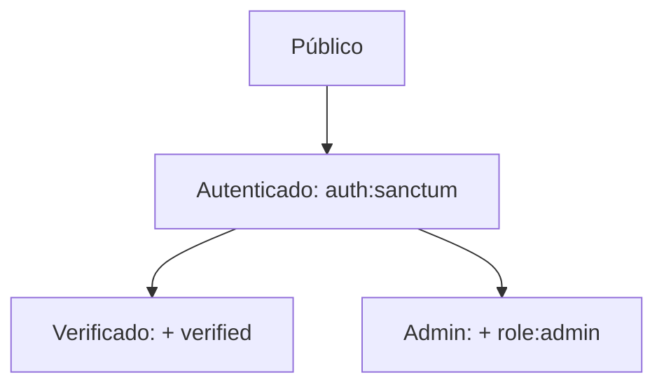

# API — Cine Sendera

Referencia de las rutas de la API, verificada contra `backend/routes/api.php` y los controladores. El detalle de cada módulo (cuerpos, respuestas, lógica) está en [`docs/modulos/`](modulos/README.md); la arquitectura, en [backend-architecture.md](backend-architecture.md). La especificación interactiva (Swagger UI) se sirve en `/api/documentation`.

## Convenciones

| Atributo         | Valor                                                            |
| ---------------- | ---------------------------------------------------------------- |
| Base URL         | `/api`                                                           |
| Formato          | JSON (`Accept: application/json`)                                |
| Autenticación    | Laravel Sanctum, cabecera `Authorization: Bearer <token>`        |
| Claves / valores | Claves en inglés; mensajes en español                            |
| Respuestas       | Recursos sin envoltorio `data` (`JsonResource::withoutWrapping`) |

## Niveles de protección

| Nivel       | Middleware aplicado          | Condición                          |
| ----------- | ---------------------------- | ---------------------------------- |
| Público     | ninguno                      | —                                  |
| Autenticado | `auth:sanctum`               | Token válido                       |
| Verificado  | `auth:sanctum`, `verified`   | Además `email_verified_at` no nulo |
| Admin       | `auth:sanctum`, `role:admin` | Además `users.role = admin`        |

## Endpoints

### Autenticación

| Método | Ruta                               | Nivel       | Descripción                                                                                    |
| ------ | ---------------------------------- | ----------- | ---------------------------------------------------------------------------------------------- |
| POST   | `/register`                        | Público     | Crea la cuenta (rol `client`), envía el correo de verificación y devuelve `user` y `token` (201) |
| POST   | `/login`                           | Público     | Valida credenciales y devuelve `user` y `token`; `throttle:5,1`                                |
| POST   | `/logout`                          | Autenticado | Revoca el token actual                                                                         |
| POST   | `/email/verification-notification` | Autenticado | Reenvía el enlace de verificación (204 si ya estaba verificado); `throttle:6,1`                |
| GET    | `/email/verify/{id}/{hash}`        | Autenticado | Valida el enlace firmado (`signed`) y marca el correo como verificado; `throttle:6,1`          |

### Cartelera

| Método | Ruta               | Nivel   | Descripción                                                                                           |
| ------ | ------------------ | ------- | ----------------------------------------------------------------------------------------------------- |
| GET    | `/movies`          | Público | Lista las películas activas                                                                           |
| GET    | `/movies/{id}`     | Público | Detalle de la película con sus funciones abiertas, sala y asientos disponibles; 404 si no existe o está inactiva |
| GET    | `/screenings/{id}` | Público | Datos de la función y mapa de asientos ocupados; 404 si no existe                                     |

### Compras y tickets

| Método | Ruta                      | Nivel      | Descripción                                                                                           |
| ------ | ------------------------- | ---------- | ----------------------------------------------------------------------------------------------------- |
| POST   | `/purchases`              | Verificado | Reserva los asientos y confirma el pago en una transacción; devuelve `purchase_id` y `payment_status` (201) |
| DELETE | `/purchases/{purchaseId}` | Verificado | Cancela una compra propia; devuelve `purchase_status`                                                 |
| GET    | `/my-tickets`             | Verificado | Tickets activos del usuario autenticado                                                               |
| GET    | `/tickets/{ticket_code}`  | Verificado | Detalle de un ticket; solo su dueño (403 en otro caso)                                                |

Cuerpo de `POST /purchases`:

| Campo                 | Tipo    | Regla                                             |
| --------------------- | ------- | ------------------------------------------------- |
| `screening_id`        | entero  | Obligatorio; debe existir en `screenings`         |
| `seats`               | arreglo | Obligatorio, mínimo un elemento                   |
| `seats.*.row`         | texto   | Una letra A-Z                                     |
| `seats.*.seat_number` | entero  | Entre 1 y 30 (y dentro de los límites de la sala) |
| `payment_method`      | texto   | `cash`, `card` u `online`                         |

Las reglas de negocio de la compra (disponibilidad de la función, precio, cancelación, `ticket_code`) están en [reglas-de-negocio.md](reglas-de-negocio.md).

### Administración

| Método | Ruta              | Nivel | Descripción                                                                            |
| ------ | ----------------- | ----- | -------------------------------------------------------------------------------------- |
| GET    | `/admin/metrics`  | Admin | Tickets vendidos, ventas del día, usuarios, película más vendida y ventas semanales    |
| GET    | `/admin/activity` | Admin | Eventos recientes de compras y pagos fallidos                                          |
| GET    | `/admin/rooms`    | Admin | Estado de cada sala (`showing`, `upcoming` o `idle`) con su ocupación                  |
| GET    | `/admin/system`   | Admin | Uso de CPU y RAM del servidor (`cpu_percent`, `cpu_label`, `ram_percent`, `ram_label`) |

### Salud

| Método | Ruta  | Nivel   | Descripción                                        |
| ------ | ----- | ------- | -------------------------------------------------- |
| GET    | `/up` | Público | Health check de Laravel (fuera del prefijo `/api`) |

## Errores

| Código | Causa                                                                                                       |
| ------ | ----------------------------------------------------------------------------------------------------------- |
| 401    | Token ausente o inválido; credenciales incorrectas en `/login`                                              |
| 403    | Correo no verificado, rol distinto de `admin`, enlace con firma inválida, ticket o compra ajenos            |
| 404    | Recurso inexistente (película, función, ticket, compra)                                                     |
| 409    | Asiento ya reservado (incluye `row` y `seat_number`) o compra ya cancelada                                  |
| 422    | Validación fallida (`message` y `errors` por campo), asiento inexistente en la sala o función no disponible |
| 429    | Límite de peticiones superado (`throttle`)                                                                  |
