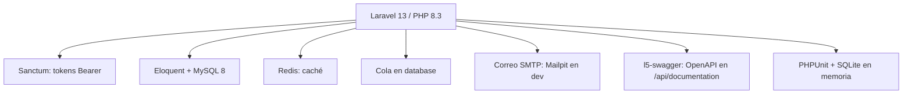
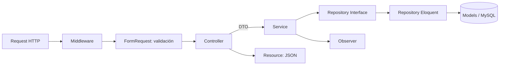
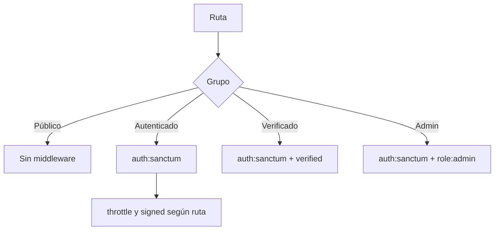
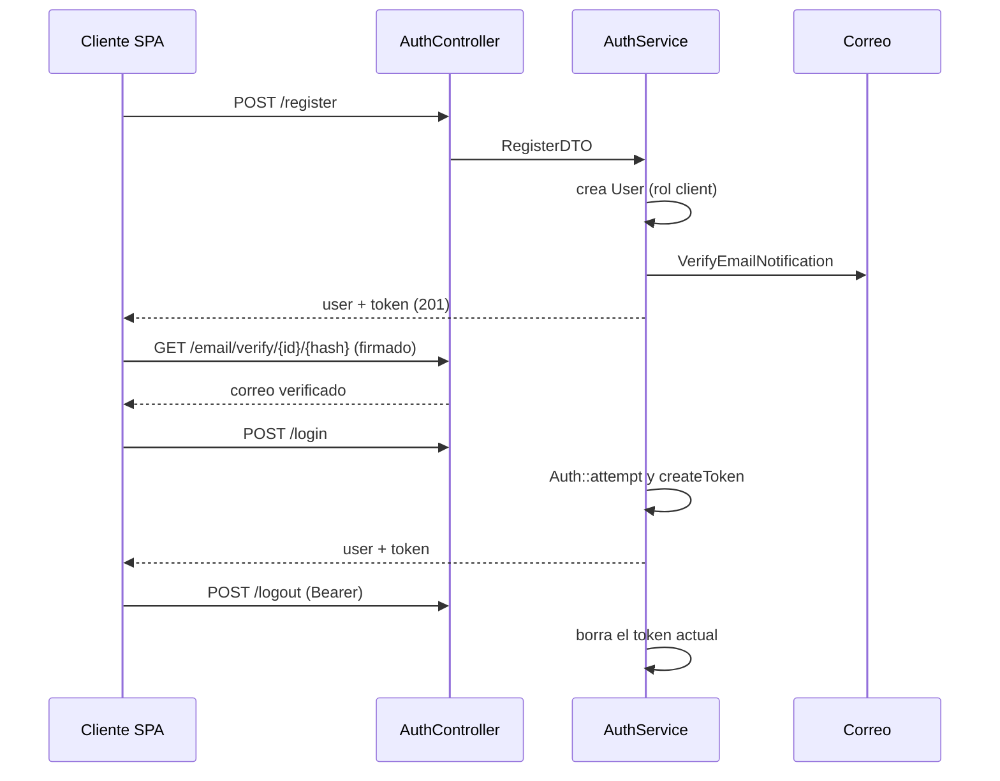
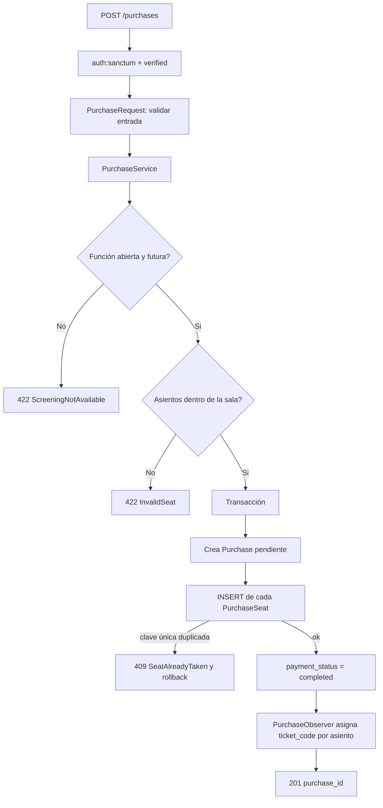

# Arquitectura del Backend — Cine Sendera

Laravel 13 / PHP 8.3 expuesto como API REST bajo `/api`, con patrón **Service + Repository + DTO**. Índice general en [backend/README.md](../backend/README.md). Rutas en [api-endpoints.md](api-endpoints.md); esquema en [database-design.md](database-design.md); reglas de negocio en [reglas-de-negocio.md](reglas-de-negocio.md); entorno Docker en [docker-entorno-desarrollo.md](docker-entorno-desarrollo.md).

## 1. Estándares

| Ámbito                         | Idioma                       |
| ------------------------------ | ---------------------------- |
| Código y base de datos         | Inglés                       |
| Textos visibles al usuario     | Español                      |
| Documentación                  | Español                      |

## 2. Tecnologías

## 3. Arquitectura por capas

La lógica de negocio vive solo en los Services; los controladores son delgados.

| Capa           | Ubicación (`backend/app/`)       | Responsabilidad                                                                 |
| -------------- | -------------------------------- | ------------------------------------------------------------------------------- |
| Controllers    | `Http/Controllers/{Admin,Auth,Movie,Purchase,Screening}` | Recibir la petición, delegar al Service, devolver Resource o JSON; llevan las anotaciones OpenAPI |
| Form Requests  | `Http/Requests/{Auth,Purchase}`  | `LoginRequest`, `RegisterRequest`, `PurchaseRequest`                            |
| DTOs           | `DTOs/{Auth,Purchase}`           | `LoginDTO`, `RegisterDTO`, `PurchaseDTO`, creados con `fromArray`               |
| Services       | `Services/`                      | `AuthService`, `MovieService`, `ScreeningService`, `PurchaseService`, `AdminService` |
| Repositories   | `Repositories/{Contracts,Eloquent}` | Interfaces y su implementación para `Movie`, `Screening` y `Purchase`        |
| Models         | `Models/`                        | `User`, `Movie`, `Room`, `Screening`, `Purchase`, `PurchaseSeat`                |
| Resources      | `Http/Resources/`                | `MovieResource`, `ScreeningResource`, `PurchaseResource`, `TicketResource`, `UserResource` |
| Observers      | `Observers/`                     | `PurchaseObserver`: asigna `ticket_code` al completarse el pago                 |
| Exceptions     | `Exceptions/`                    | Excepciones de dominio que se renderizan solas como JSON                        |
| Console        | `Console/Commands/`              | `demo:reset` y `screenings:refresh-demo`                                        |
| Notifications  | `Notifications/`                 | `VerifyEmailNotification`                                                       |

Las interfaces de repositorio se enlazan a su implementación en `AppServiceProvider`, que además registra el observer y desactiva el envoltorio `data` de los Resources.

Notas de alcance: `AdminService` consulta modelos directamente (sin repositorio), igual que `PurchaseService` en parte de su lógica, y `PurchaseController::showTicket` carga el modelo `PurchaseSeat` sin pasar por un Service. No existe la carpeta `Policies/`: la autorización se resuelve con middleware y comprobaciones de propietario en los Services.

## 4. Enrutamiento y middleware

Las rutas se registran en `bootstrap/app.php`: `routes/web.php` (captura todo lo que no sea `/api/*` y sirve el `index.html` de React), `routes/api.php` (API), `routes/console.php` (scheduler) y el health check `/up`. El alias `role` apunta a `EnsureIsAdmin`.

| Middleware       | Función                                                                  |
| ---------------- | ------------------------------------------------------------------------ |
| `auth:sanctum`   | Exige token Bearer válido (401 si falta)                                 |
| `verified`       | Exige correo verificado (403 si no)                                      |
| `role:admin`     | `EnsureIsAdmin`: responde 403 si `users.role` no es `admin`              |
| `signed`         | Valida la firma del enlace de verificación de correo                     |
| `throttle:5,1`   | Limita `/login` a 5 intentos por minuto                                  |
| `throttle:6,1`   | Limita el reenvío y la verificación de correo a 6 por minuto             |

Los roles (`admin`, `cashier`, `client`) se guardan como ENUM en `users.role`; hoy solo `admin` tiene tratamiento distinto en la API. La tabla completa de rutas y su nivel de protección está en [api-endpoints.md](api-endpoints.md).

## 5. Flujo de autenticación (Sanctum)

Los tokens no caducan (`sanctum.expiration` es nulo): se invalidan solo al hacer logout. Las credenciales inválidas lanzan `InvalidCredentialsException` (401).

## 6. Flujo de compra

Decisiones de diseño que se mantienen:

- No hay pre-chequeo con `exists()`: se intenta el INSERT y se captura `UniqueConstraintViolationException`, porque la restricción UNIQUE de `purchase_seats` es la garantía real contra la doble reserva (ver [database-design.md](database-design.md)).
- El rollback de la transacción deshace la compra y todos sus asientos si alguno falla.
- El `ticket_code` lo asigna el `PurchaseObserver` al pasar `payment_status` a `completed`, nunca de forma directa en la petición.
- El precio de cada asiento se guarda en `price_paid` (histórico).

La cancelación (`DELETE /purchases/{purchaseId}`) pasa por `PurchaseService::cancelPurchase`, que comprueba existencia (404), propietario (403) y que no esté ya cancelada (409). Dentro de una transacción, marca `purchase_status = 'cancelled'` y elimina las filas de `purchase_seats`, liberando la restricción UNIQUE para que los asientos puedan re-comprarse. Las reglas detalladas están en [reglas-de-negocio.md](reglas-de-negocio.md).

## 7. Manejo de errores

Las excepciones de dominio implementan `toResponse` y devuelven JSON con `message` directamente, sin pasar por el handler global (que está vacío en `bootstrap/app.php`).

| Excepción                          | Código |
| ---------------------------------- | ------ |
| `InvalidCredentialsException`      | 401    |
| `UnauthorizedPurchaseException`    | 403    |
| `PurchaseNotFoundException`        | 404    |
| `SeatAlreadyTakenException`        | 409 (incluye `row` y `seat_number`) |
| `PurchaseAlreadyCancelledException`| 409    |
| `InvalidSeatException`             | 422    |
| `ScreeningNotAvailableException`   | 422    |

## 8. Seguridad

| Medida               | Implementación                                                               |
| -------------------- | ---------------------------------------------------------------------------- |
| Autenticación        | Sanctum con tokens Bearer; contraseñas con hash (cast `hashed` en `User`)    |
| Autorización         | Middleware `role:admin`, `verified` y comprobación de propietario en compras y tickets |
| Validación           | Form Requests en registro, login y compra (contraseña de 8 a 72 caracteres, correo único) |
| Fuerza bruta         | `throttle` en login y verificación de correo                                 |
| Inyección SQL        | Solo Eloquent y Query Builder                                                |
| CORS                 | `config/cors.php` limita `api/*` a los orígenes de la configuración, sin credenciales |
| Integridad de datos  | Restricción UNIQUE de asientos y transacciones en la compra                  |

## 9. Tareas programadas y comandos

| Comando                      | Cuándo corre                                              | Qué hace                                                             |
| ---------------------------- | --------------------------------------------------------- | -------------------------------------------------------------------- |
| `demo:reset`                 | Diario 00:05 (`DEMO_TIMEZONE`) si `DEMO_MODE=true`         | Vacía `purchase_seats` y `purchases`, reabre funciones agotadas y reagenda las pasadas |
| `screenings:refresh-demo`    | Lo invoca `demo:reset`; opción `--days` (7 por defecto)   | Mueve las funciones pasadas a un día aleatorio posterior, evitando solapes en la sala |

El scheduler se registra en `routes/console.php`; en producción lo ejecuta el contenedor `scheduler` con `schedule:work`. `demo:reset --force` permite ejecutarlo sin `DEMO_MODE`. Despliegue y CI: [ci-cd.md](ci-cd.md) y [deployment-servidor-personal.md](deployment-servidor-personal.md).

## 10. Documentación OpenAPI y pruebas

- Las anotaciones OpenAPI (atributos `#[OA\...]`) viven en los controladores y Form Requests. La interfaz se sirve en `/api/documentation` y la especificación se regenera con el comando `php artisan l5-swagger:generate`.
- Los tests (`composer test`) usan SQLite en memoria: `tests/Unit/Services` (`AuthServiceTest`, `PurchaseServiceTest`) y `tests/Feature` (controladores HTTP, CORS, seeder del admin y comandos de demo).
- Estilo de código con Laravel Pint.
