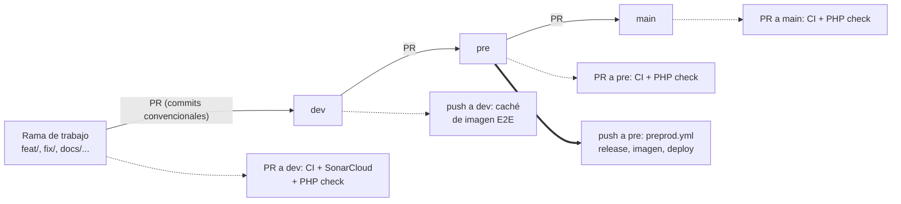
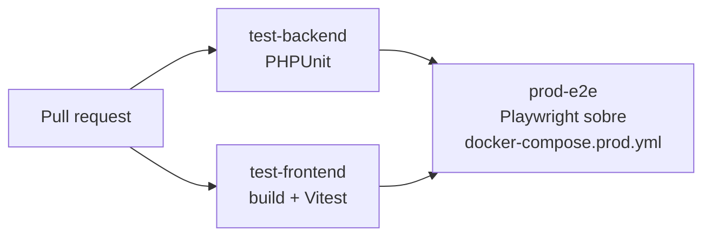
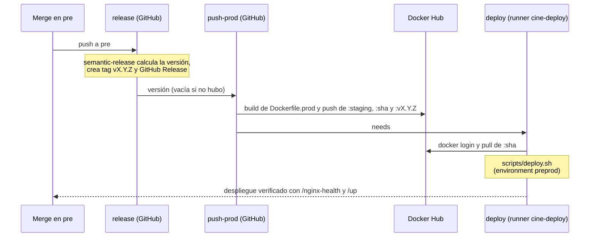

# CI/CD y flujo de ramas

> **Navegación:** [README](../README.md) · [Entorno de desarrollo](./docker-entorno-desarrollo.md) · **CI/CD** · [Producción simulada](./deployment-produccion.md) · [Servidor personal (preproducción)](./deployment-servidor-personal.md) · [Arquitectura del backend](./backend-architecture.md) · [Base de datos](./database-design.md)

Este documento describe los workflows de `.github/workflows/`, el flujo de ramas `dev` → `pre` → `main`, el versionado automático con semantic-release y la publicación de imágenes. El detalle del despliegue en el servidor está en [deployment-servidor-personal.md](./deployment-servidor-personal.md).

---

## Flujo de ramas y promoción de entornos

Ningún cambio se commitea directamente en `dev`, `pre` ni `main`: todo pasa por una rama de trabajo y una pull request hacia `dev`.

| Rama | Entorno | Cómo recibe cambios | Qué se ejecuta |
| :--- | :--- | :--- | :--- |
| `feat/*`, `fix/*`, `docs/*`, `ci/*`, `refactor/*`, `chore/*`, `test/*` | Local | Se crean desde `origin/dev` | Entorno Docker de [desarrollo](./docker-entorno-desarrollo.md) |
| `dev` | Integración | PR desde una rama de trabajo | CI y SonarCloud en la PR; caché de imagen E2E en el push |
| `pre` | Preproducción (simulación en el servidor personal) | PR desde `dev` | CI en la PR; en el push, semantic-release, publicación de la imagen y despliegue |
| `main` | Producción | PR desde `pre` | CI en la PR. No hay workflow de despliegue asociado a `main` todavía |

Reglas de la contribución:

| Regla | Detalle |
| :--- | :--- |
| Origen de la rama | `git fetch origin` y rama nueva desde `origin/dev`. |
| Prefijo | `feat/`, `fix/`, `refactor/`, `docs/`, `ci/`, `chore/`, `test/`, según el tipo de cambio. |
| Commits | Conventional Commits, escritos en español; semantic-release deduce la versión de ellos. |
| Pull request | Base `dev`. Los cambios no relacionados van en ramas y PR separadas. |
| Trabajo iniciado en `dev` por error | Moverlo a una rama nueva antes de commitear (`git switch -c <tipo>/<nombre>` conserva los cambios sin commitear). |
| Revisión automática | Comentar `@claude` en una PR dispara la revisión de código (ver abajo). |

---

## Resumen de workflows

| Workflow | Archivo | Disparador | Propósito |
| :--- | :--- | :--- | :--- |
| CI | `ci.yml` | PR hacia `dev`, `pre` o `main` | Tests de backend y frontend, y E2E contra el stack de producción |
| SonarCloud | `sonarcloud.yml` | PR hacia `dev` | Análisis estático de calidad |
| E2E Image Cache | `e2e-image-cache.yml` | Push a `dev` (cambios en Dockerfile, backend o frontend) y manual | Calienta la caché de capas Docker que usa el E2E |
| PHP Version Security Check | `php-version-check.yml` | PR hacia `dev`, `pre` o `main`, y cada lunes a las 08:00 UTC | Verifica que PHP esté en un parche seguro |
| Preproducción | `preprod.yml` | Push a `pre` | Versionado, publicación de imagen y despliegue |
| Claude Code Review | `claude-code-review.yml` | Comentario con `@claude` en una PR | Revisión de código asistida |

Todos los workflows fijan cada acción por *commit SHA* (con la versión en un comentario) y declaran permisos mínimos.

---

## Workflow `ci.yml`

Se ejecuta en cada PR hacia `dev`, `pre` o `main`. La concurrencia (`ci-<ref>`) cancela la ejecución anterior de la misma rama cuando llega un nuevo push.

| Job | Qué hace |
| :--- | :--- |
| `test-backend` | PHP 8.3.36 con `pdo_sqlite`; instala Composer (con caché), genera `APP_KEY` de testing y ejecuta `php artisan test` sobre SQLite en memoria. |
| `test-frontend` | Node 22; `npm ci --ignore-scripts`, `npm run build` (verifica que compile) y `npm run test` (Vitest). El lint no forma parte del workflow. |
| `prod-e2e` | Depende de los dos anteriores. Ver detalle a continuación. |

### Job `prod-e2e`

1. Prepara `.env.prod` a partir de `.env.prod.example`, con la `APP_KEY` del secret `APP_KEY`, contraseñas de CI y un administrador de prueba (`ADMIN_EMAIL` / `ADMIN_PASSWORD` definidos en el workflow).
2. Construye `docker/php/Dockerfile.prod` con Buildx y `VITE_DEMO_MODE=true`, etiquetándola `cine-sendera:prod`. La caché de capas (`type=gha`, ámbito `e2e-prod`) **solo se lee**: la escribe `e2e-image-cache.yml`, porque exportarla desde cada PR añadía tiempo y llenaba la cuota.
3. Arranca `mysql` y `mailpit` sin esperar a que `app` esté lista, para que MySQL (el healthcheck más lento) se inicialice mientras se instala Playwright.
4. Instala Node 22 y las dependencias del frontend, y Chromium de Playwright (con caché por versión).
5. Levanta el resto con `up -d --no-build --wait --wait-timeout 180`, que bloquea hasta que los healthchecks pasan.
6. Ejecuta `npx playwright test` con `BASE_URL=http://localhost`.
7. Si falla, muestra los últimos 200 renglones de logs de Compose y sube el informe de Playwright como artefacto (`playwright-report-prod`, 14 días).

---

## Workflow `sonarcloud.yml`

Analiza solo las PR hacia `dev` (las de `pre` y `main`, y los pushes, no se analizan). Hace *checkout* con historial completo para el *blame* y la detección de código nuevo, y usa la acción oficial de SonarQube Cloud con `SONAR_TOKEN`, la organización `josmanmor` y el proyecto `JosManMor_cine_web`.

El job se omite en las PR desde forks (no reciben secretos); un check omitido cuenta como superado en la protección de ramas. Requiere desactivar el análisis automático en SonarCloud.

---

## Workflow `e2e-image-cache.yml`

Las PR solo pueden leer la caché de Actions de su rama base. Este workflow construye `Dockerfile.prod` en cada push a `dev` que toque el Dockerfile, el entrypoint de producción, `backend/` o `frontend/`, y exporta las capas (`mode=max`, ámbito `e2e-prod`) sin publicar nada. Así el job `prod-e2e` reutiliza apt, Composer y npm desde el primer push de una PR. Tiene concurrencia propia que cancela ejecuciones anteriores.

---

## PHP Version Security Check

`php-version-check.yml` lee la versión fijada en `FROM php:X.Y.Z` de `docker/php/Dockerfile` y `docker/php/Dockerfile.prod`. Falla si no hay versión fijada (etiqueta flotante) o si la 8.3 está por debajo del parche mínimo (`8.3.36`, por las vulnerabilidades *PHP2Shell*). Además de las PR, se ejecuta cada lunes para detectar imágenes desactualizadas. Al subir el parche de PHP hay que actualizar a la vez los dos Dockerfiles, el valor mínimo del workflow y `php-version` en `ci.yml`.

---

## Workflow `preprod.yml`

Se dispara en cada push a `pre` y tiene tres jobs encadenados. La concurrencia por *commit* cancela ejecuciones duplicadas del mismo SHA.

| Job | Runner | Qué hace |
| :--- | :--- | :--- |
| `release` | GitHub (`ubuntu-latest`) | Ejecuta semantic-release (instalado con versiones fijas y `--ignore-scripts`, sin `npx`). Su concurrencia `release-pre` es en serie para que dos releases simultáneas no calculen la misma versión. Expone la versión creada (el tag que apunta a `HEAD`). |
| `push-prod` | GitHub | Inicia sesión en Docker Hub, construye `docker/php/Dockerfile.prod` con `VITE_DEMO_MODE=true` y publica los tags. |
| `deploy` | Self-hosted (`self-hosted`, `linux`, `cine-deploy`) | Environment `preprod`; concurrencia `deploy-preprod` sin cancelación (un despliegue a la vez). Inicia sesión en Docker Hub, ejecuta `scripts/deploy.sh` con `CINE_IMAGE=<usuario>/cine-sendera:<sha>` y siempre cierra sesión al terminar. |

### Imágenes publicadas

| Tag | Contenido |
| :--- | :--- |
| `<usuario>/cine-sendera:staging` | Última imagen construida desde `pre` |
| `<usuario>/cine-sendera:<sha>` | Imagen exacta de ese commit; es la que se despliega y sirve para el rollback |
| `<usuario>/cine-sendera:vX.Y.Z` | Solo si el merge generó versión; es la misma imagen que `:<sha>` |

El procedimiento en el servidor (runner, directorio, rollback, reinicio diario de la demo) está en [deployment-servidor-personal.md](./deployment-servidor-personal.md).

---

## Versionado con semantic-release

El proyecto se versiona **al hacer merge en `pre`** con [SemVer](https://semver.org/lang/es/) y [semantic-release](https://semantic-release.org/) (configuración en `.releaserc.json`: rama `pre`, formato de tag `vX.Y.Z`, preset `conventionalcommits`). Nadie elige la versión a mano: se deduce de los mensajes de commit desde el último tag.

| Commit | Efecto | Ejemplo |
| :--- | :--- | :--- |
| `fix: ...` o `perf: ...` | PARCHE (`1.2.0` a `1.2.1`) | `fix(docker): corregir healthcheck` |
| `feat: ...` | MENOR (`1.2.0` a `1.3.0`) | `feat(ui): rediseño de la cartelera` |
| `feat!: ...` o `BREAKING CHANGE:` en el cuerpo | MAYOR (`1.2.0` a `2.0.0`) | `feat(api)!: renombrar /purchases` |
| `docs`, `chore`, `ci`, `refactor`, `test`, `style`, `build` | Ninguno | `docs: actualizar README` |

Si un merge a `pre` no contiene ningún commit que versione, no se crea tag ni release, pero el despliegue se realiza igual. Los commits `Merge pull request ...` se ignoran: cuentan los mensajes de los commits de cada rama, por eso importa escribirlos bien.

Resultado de cada versión: tag `vX.Y.Z` sobre el commit desplegado, GitHub Release con notas generadas desde los commits e imagen `cine-sendera:vX.Y.Z`. La primera ejecución analiza todo el historial y publica `v1.0.0`. Como `.releaserc.json` solo contempla `pre`, el paso a `main` no genera una versión nueva.

---

## Workflow `claude-code-review.yml`

Se dispara al crear un comentario en una PR que contenga `@claude`. Obtiene la lista de archivos modificados con la API de GitHub y ejecuta el plugin `code-review` de Claude Code limitado a esos archivos, publicando la revisión en la PR. Usa el secret `CLAUDE_CODE_OAUTH_TOKEN` y permisos de escritura en PR e issues.

---

## Secretos y variables

| Nombre | Tipo | Usado en |
| :--- | :--- | :--- |
| `APP_KEY` | secret | `ci.yml` (clave de Laravel para el E2E) |
| `SONAR_TOKEN` | secret | `sonarcloud.yml` |
| `DOCKERHUB_USERNAME` / `DOCKERHUB_TOKEN` | secret | `preprod.yml` |
| `CLAUDE_CODE_OAUTH_TOKEN` | secret | `claude-code-review.yml` |
| `GITHUB_TOKEN` | automático | `preprod.yml` (crear tag y release) |
| `DEPLOY_DIR` | variable (opcional) | `preprod.yml`, ruta de despliegue en el servidor |

---

## Demo reset (relación con el pipeline)

El reinicio diario de la demo no es un workflow: lo ejecuta el contenedor `scheduler` del stack de producción (`schedule:work`), con `demo:reset` a las 00:05 cuando `DEMO_MODE=true`. Se describe en [deployment-servidor-personal.md](./deployment-servidor-personal.md#reinicio-diario-de-la-demo).
