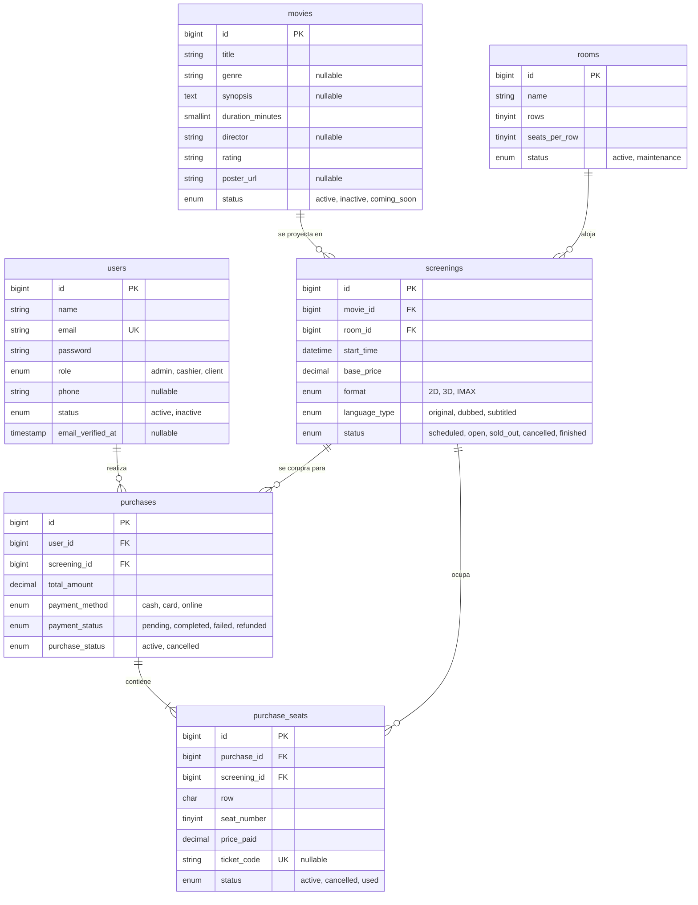

# Diseño de Base de Datos — Cine Sendera

> Fuente de verdad del esquema. Las reglas de negocio están en [reglas-de-negocio.md](reglas-de-negocio.md).

Sistema de simulación de cartelera y venta de entradas. Permite explorar películas, seleccionar asientos, comprar entradas y recibir tickets digitales. Incluye panel administrativo para gestión de películas, funciones y reportes básicos.

**Stack:** React (SPA) + Laravel 13 (PHP 8.3) + MySQL 8 + REST API

---

## Decisiones de diseño

| Decisión                                | Justificación                                                                                                                                                                                                                            |
| --------------------------------------- | ---------------------------------------------------------------------------------------------------------------------------------------------------------------------------------------------------------------------------------------- |
| Sin tabla `seats`                       | Todas las salas comparten el mismo esquema de asientos (filas × columnas). El mapa se calcula desde `rooms.rows` y `rooms.seats_per_row`; no tiene sentido pre-poblar miles de registros.                                                |
| Solo se almacenan asientos **ocupados** | `purchase_seats` actúa como tabla de ocupación. Un asiento libre es simplemente uno que no aparece en esta tabla para esa función.                                                                                                       |
| `role` como ENUM en `users`             | Tres roles fijos (admin, cashier, client). Un sistema de permisos granular es sobre-ingeniería para una simulación (ver [roles y permisos](reglas-de-negocio.md#roles-y-permisos)).                                                                                                                   |
| `genre` como VARCHAR en `movies`        | Catálogo estático y sin relaciones cruzadas; no justifica tabla separada.                                                                                                                                                                |
| Sin `promotions` ni `payment_methods`   | Fuera del alcance de la simulación.                                                                                                                                                                                                      |
| Sin tabla `tickets`                     | Un asiento comprado y un ticket son lo mismo en el prototipo. `ticket_code` y el estado (used) se mueven directamente a `purchase_seats`. El QR se genera en tiempo real a partir del código; no hay nada que persistir.                 |
| Sin soft delete                         | Para desactivar una película basta con el campo `status`; en `users` el campo existe pero hoy no se aplica ([ver reglas](reglas-de-negocio.md#desactivación-sin-borrado)). El borrado lógico complica las consultas sin aportar al prototipo.                                                                                                    |
| Sin `end_time` en `screenings`          | Dato calculable: `start_time + movies.duration_minutes`. Persistirlo obliga a mantenerlo sincronizado manualmente.                                                                                                                       |
| `timestamps()` en entidades mutables    | `users`, `movies`, `rooms`, `screenings` y `purchases` incluyen `created_at` y `updated_at` para auditoría de cambios de estado (rol, cancelación, desactivación). `purchase_seats` no los tiene: es una tabla de ocupación inmutable una vez creada. |
| `email_verified_at` en `users`          | Requerido por `MustVerifyEmail` de Laravel. Permite proteger rutas sensibles (ej. compras) con el middleware `verified`.                                                                                                                 |
| Sin `remember_token`                    | La autenticación usa Sanctum Bearer Token; no se usan sesiones persistentes de browser.                                                                                                                                                  |

---

## Esquema — 6 tablas de negocio y tablas de infraestructura

### users

| Campo             | Tipo            | Restricciones                                            |
| ----------------- | --------------- | -------------------------------------------------------- |
| id                | BIGINT UNSIGNED | PK, AUTO_INCREMENT                                       |
| name              | VARCHAR(255)    | NOT NULL                                                 |
| email             | VARCHAR(255)    | UNIQUE, NOT NULL                                         |
| password          | VARCHAR(255)    | NOT NULL                                                 |
| role              | ENUM            | NOT NULL DEFAULT `client` → `admin`, `cashier`, `client` |
| phone             | VARCHAR(20)     | NULLABLE                                                 |
| status            | ENUM            | NOT NULL DEFAULT `active` → `active`, `inactive`         |
| email_verified_at | TIMESTAMP       | NULLABLE                                                 |
| created_at        | TIMESTAMP       | —                                                        |
| updated_at        | TIMESTAMP       | —                                                        |

---

### Tablas de infraestructura

Las gestiona Laravel y no forman parte del modelo de negocio: `password_reset_tokens` (creada, sin flujo de recuperación implementado), `personal_access_tokens` (tokens Bearer de Sanctum), `cache`, `cache_locks`, `jobs`, `job_batches`, `failed_jobs` y `sessions`.

#### password_reset_tokens

| Campo      | Tipo         | Restricciones |
| ---------- | ------------ | ------------- |
| email      | VARCHAR(255) | PK            |
| token      | VARCHAR(255) | NOT NULL      |
| created_at | TIMESTAMP    | NULLABLE      |

---

### movies

| Campo            | Tipo              | Restricciones                                                   |
| ---------------- | ----------------- | --------------------------------------------------------------- |
| id               | BIGINT UNSIGNED   | PK, AUTO_INCREMENT                                              |
| title            | VARCHAR(255)      | NOT NULL                                                        |
| genre            | VARCHAR(100)      | NULLABLE                                                        |
| synopsis         | TEXT              | NULLABLE                                                        |
| duration_minutes | SMALLINT UNSIGNED | NOT NULL                                                        |
| director         | VARCHAR(255)      | NULLABLE                                                        |
| rating           | VARCHAR(10)       | NOT NULL → G, PG, PG-13, R                                      |
| poster_url       | VARCHAR(500)      | NULLABLE                                                        |
| status           | ENUM              | NOT NULL DEFAULT `active` → `active`, `inactive`, `coming_soon` |
| created_at       | TIMESTAMP         | —                                                               |
| updated_at       | TIMESTAMP         | —                                                               |

---

### rooms

El layout de asientos se define aquí. No hay tabla de asientos individuales.

| Campo         | Tipo             | Restricciones                              |
| ------------- | ---------------- | ------------------------------------------ |
| id            | BIGINT UNSIGNED  | PK, AUTO_INCREMENT                         |
| name          | VARCHAR(100)     | NOT NULL → "Sala 1", "Sala VIP"            |
| rows          | TINYINT UNSIGNED | NOT NULL → cantidad de filas (A, B, C…)    |
| seats_per_row | TINYINT UNSIGNED | NOT NULL → asientos por fila               |
| status        | ENUM             | DEFAULT `active` → `active`, `maintenance` |
| created_at    | TIMESTAMP        | —                                          |
| updated_at    | TIMESTAMP        | —                                          |

**Capacidad total:** `rows × seats_per_row` (calculado, no almacenado).

---

### screenings

| Campo         | Tipo            | Restricciones                                                                  |
| ------------- | --------------- | ------------------------------------------------------------------------------ |
| id            | BIGINT UNSIGNED | PK, AUTO_INCREMENT                                                             |
| movie_id      | BIGINT UNSIGNED | FK → movies.id, NOT NULL                                                       |
| room_id       | BIGINT UNSIGNED | FK → rooms.id, NOT NULL                                                        |
| start_time    | DATETIME        | NOT NULL                                                                       |
| base_price    | DECIMAL(10,2)   | NOT NULL                                                                       |
| format        | ENUM            | DEFAULT `2D` → `2D`, `3D`, `IMAX`                                              |
| language_type | ENUM            | DEFAULT `subtitled` → `original`, `dubbed`, `subtitled`                        |
| status        | ENUM            | DEFAULT `scheduled` → `scheduled`, `open`, `sold_out`, `cancelled`, `finished` |
| created_at    | TIMESTAMP       | —                                                                              |
| updated_at    | TIMESTAMP       | —                                                                              |

---

### purchases

| Campo           | Tipo            | Restricciones                                                    |
| --------------- | --------------- | ---------------------------------------------------------------- |
| id              | BIGINT UNSIGNED | PK, AUTO_INCREMENT                                               |
| user_id         | BIGINT UNSIGNED | FK → users.id, NOT NULL                                          |
| screening_id    | BIGINT UNSIGNED | FK → screenings.id, NOT NULL                                     |
| total_amount    | DECIMAL(10,2)   | NOT NULL                                                         |
| payment_method  | ENUM            | NULLABLE → `cash`, `card`, `online`                              |
| payment_status  | ENUM            | DEFAULT `pending` → `pending`, `completed`, `failed`, `refunded` |
| purchase_status | ENUM            | DEFAULT `active` → `active`, `cancelled`                         |
| created_at      | TIMESTAMP       | —                                                                |
| updated_at      | TIMESTAMP       | —                                                                |

---

### purchase_seats

**Tabla de ocupación y tickets.** Solo contiene asientos reservados; los libres no existen como registros. El `ticket_code` se asigna al confirmar el pago ([regla](reglas-de-negocio.md#tickets)); el QR se genera en el cliente a partir de él.

| Campo        | Tipo             | Restricciones                                     |
| ------------ | ---------------- | ------------------------------------------------- |
| id           | BIGINT UNSIGNED  | PK, AUTO_INCREMENT                                |
| purchase_id  | BIGINT UNSIGNED  | FK → purchases.id, NOT NULL                       |
| screening_id | BIGINT UNSIGNED  | FK → screenings.id, NOT NULL                      |
| row          | CHAR(2)          | NOT NULL → "A", "B", …                            |
| seat_number  | TINYINT UNSIGNED | NOT NULL → 1, 2, 3…                               |
| price_paid   | DECIMAL(10,2)    | NOT NULL (precio histórico)                       |
| ticket_code  | VARCHAR(100)     | UNIQUE, NULLABLE (se asigna al completar el pago) |
| status       | ENUM             | DEFAULT `active` → `active`, `cancelled`, `used`  |
| **UNIQUE**   | —                | **(screening_id, row, seat_number)**              |

> La restricción `UNIQUE (screening_id, row, seat_number)` es la garantía contra doble reserva. Cómo usarla dentro de la transacción se explica en [reglas-de-negocio.md](reglas-de-negocio.md#asientos-y-doble-reserva).

---

## Diagrama entidad-relación

Todas las claves foráneas son `NOT NULL` y sin borrado en cascada, salvo `purchase_seats.purchase_id`, que sí es `ON DELETE CASCADE`.

`screening_id` está denormalizado en `purchase_seats` (ya existe en `purchases`) para poder aplicar la restricción `UNIQUE` directamente, sin joins.

---

## Índices y restricciones únicas

| Tabla            | Índice                             | Tipo   | Propósito                                                                                              |
| ---------------- | ---------------------------------- | ------ | ------------------------------------------------------------------------------------------------------ |
| `users`          | `email`                            | UNIQUE | Un correo por cuenta                                                                                   |
| `movies`         | `status`                           | INDEX  | Cartelera activa                                                                                       |
| `screenings`     | `(movie_id, start_time, status)`   | INDEX  | Funciones por película y fecha                                                                         |
| `purchases`      | `(user_id, created_at)`            | INDEX  | Historial de compras por usuario                                                                       |
| `purchase_seats` | `(screening_id, row, seat_number)` | UNIQUE | Garantía de nivel de BD contra doble reserva ([regla](reglas-de-negocio.md#asientos-y-doble-reserva)) |
| `purchase_seats` | `(screening_id, status)`           | INDEX  | Disponibilidad de asientos, la consulta más frecuente en la compra                                     |
| `purchase_seats` | `ticket_code`                      | UNIQUE | Búsqueda de tickets (admite varios `NULL`)                                                             |

---

## Reglas de negocio

Las reglas que dependen de estos datos (doble reserva, asiento válido, `ticket_code`, `price_paid`, desactivación, cancelación y estados) viven en un único documento: [reglas-de-negocio.md](reglas-de-negocio.md).
