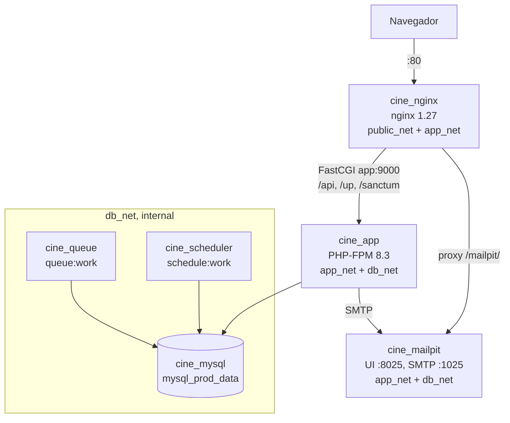
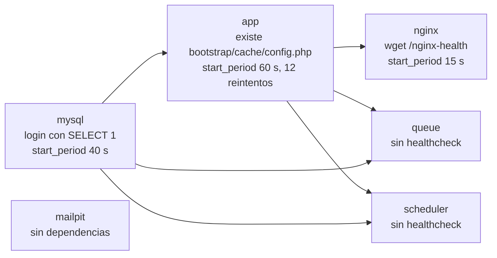
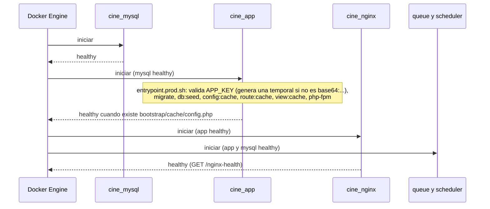

# Producción simulada (`docker-compose.prod.yml`)

> **Navegación:** [README](../README.md) · [Entorno de desarrollo](./docker-entorno-desarrollo.md) · [CI/CD](./ci-cd.md) · **Producción simulada** · [Servidor personal (preproducción)](./deployment-servidor-personal.md) · [Arquitectura del backend](./backend-architecture.md) · [Base de datos](./database-design.md)

Este documento describe el stack de producción simulada de Cine Sendera: topología, orden de arranque, primer despliegue local, operación, seguridad y solución de problemas. El despliegue automático de esta misma configuración en el servidor personal (rama `pre`) se explica en [deployment-servidor-personal.md](./deployment-servidor-personal.md), y el pipeline que construye la imagen en [ci-cd.md](./ci-cd.md).

---

## Diferencias con el entorno de desarrollo

| Aspecto | Desarrollo (`docker-compose.yml`) | Producción (`docker-compose.prod.yml`) |
| :--- | :--- | :--- |
| Archivo de entorno | `.env` (raíz) | `.env.prod` (raíz) |
| Código fuente | Bind mount `./backend` | Dentro de la imagen; se sirve desde el volumen `app_www` |
| Frontend | Servicio `frontend` (Vite, `:5173`) | Build estático en `public/build/` (etapa 2 del Dockerfile) |
| PHP vendor | `composer install` manual en el host | Instalado sin `--dev` dentro de la imagen |
| Base de datos | Publicada en el host (`FORWARD_DB_PORT`) | Solo accesible en `db_net` |
| Redis | Servicio `redis` (`CACHE_STORE=redis`) | No incluido (`CACHE_STORE=database`) |
| phpMyAdmin | Incluido | Excluido |
| Mailpit | Puertos `1025` y `8025` en el host | Sin puertos en el host; la UI se accede por `/mailpit/` a través de nginx |
| Servidor web | Apache (`httpd:2.4`) | Nginx (`nginx:1.27-alpine`) |
| Redes | 2 (`frontend_net`, `backend_net`) | 3 con DMZ (`public_net`, `app_net`, `db_net`) |
| Queue worker | No incluido | Contenedor `queue` dedicado |
| Scheduler | No incluido | Contenedor `scheduler` (`demo:reset` a las 00:05) |
| OPcache | Desactivado (`docker/php/php-dev.ini`) | Activado, sin validar timestamps |
| Usuario de `app` | `www-data` con UID/GID del host | `root` solo durante el setup; los workers de PHP-FPM y los comandos artisan usan `www-data` |
| `HOST_UID` / `HOST_GID` | Requeridas | No aplican |
| Límites de recursos | No | `deploy.resources.limits` por servicio |
| Caché de Laravel | No | `config:cache`, `route:cache` y `view:cache` en el entrypoint |

---

## Topología de contenedores y redes

Solo `nginx` toca `public_net`. `app_net` y `db_net` son redes `internal: true`: sus contenedores no tienen salida a internet ni son alcanzables desde el host.

| Contenedor | Imagen | Redes | Volúmenes | Límites |
| :--- | :--- | :--- | :--- | :--- |
| `cine_nginx` | `nginx:1.27-alpine` | `public_net`, `app_net` | `app_www` (solo lectura) y `docker/nginx/prod.conf` | 128 MB, 0,25 CPU |
| `cine_app` | `${CINE_IMAGE:-cine-sendera:prod}` | `app_net`, `db_net` | `app_www` | 512 MB, 0,75 CPU |
| `cine_mysql` | `mysql:8.0` | `db_net` | `mysql_prod_data` | 1 GB, 1 CPU |
| `cine_mailpit` | `axllent/mailpit:v1.31.4` (`MP_WEBROOT=mailpit`) | `app_net`, `db_net` | - | 64 MB, 0,10 CPU |
| `cine_queue` | misma imagen que `app` | `db_net` | `app_www` | 256 MB, 0,50 CPU |
| `cine_scheduler` | misma imagen que `app` | `db_net` | `app_www` | 128 MB, 0,25 CPU |

Detalles que conviene conocer:

- **Volumen `app_www`:** se auto-puebla desde la imagen en el primer arranque y lo comparten `app`, `nginx`, `queue` y `scheduler`. Por eso, para publicar código nuevo hay que eliminarlo (ver [Actualizar código](#actualizar-código-o-frontend)).
- **Imagen única:** `queue` y `scheduler` reutilizan la imagen de `app`; el entrypoint solo ejecuta migraciones, seeders y cachés cuando el comando es `php-fpm`.
- **Queue worker:** `queue:work --tries=3 --timeout=90 --sleep=3 --max-time=3600` (se reinicia cada hora). Conexión `QUEUE_CONNECTION=database`.
- **Scheduler:** `schedule:work` como `www-data`, para no dejar archivos de `storage/` propiedad de `root`. Con `DEMO_MODE=true` programa `demo:reset` diariamente a las 00:05 (ver [reinicio diario de la demo](./deployment-servidor-personal.md#reinicio-diario-de-la-demo)).
- **Enrutado de nginx:** las rutas `/api`, `/up` y `/sanctum` van a PHP-FPM; el resto cae en el SPA (`/build/index.html`); `/nginx-health` responde `ok` sin pasar por PHP; `/mailpit/` hace de proxy inverso (con WebSocket) hacia la UI de Mailpit.
- **Sin Redis:** la caché y las sesiones usan la base de datos (`CACHE_STORE=database`, `SESSION_DRIVER=database`).

---

## Orden de arranque y healthchecks

El healthcheck de `app` no sondea el puerto: considera al contenedor listo cuando el entrypoint terminó de generar la caché de configuración. Es lo que permite a `docker compose up --wait` (usado por el despliegue y por el job E2E) esperar a que las migraciones hayan terminado.

---

## Requisitos previos

- Docker Engine 24 o superior y Docker Compose v2.
- Acceso al repositorio.

---

## Primer despliegue

| Paso | Acción |
| :--- | :--- |
| 1 | Copiar `.env.prod.example` a `.env.prod` y editarlo (tabla siguiente). |
| 2 | Construir y levantar con `docker compose -f docker-compose.prod.yml up -d --build`. |
| 3 | Verificar con `docker compose -f docker-compose.prod.yml ps`: `app`, `nginx` y `mysql` deben estar `healthy`; `queue`, `scheduler` y `mailpit` solo `Up`. |
| 4 | Fijar la `APP_KEY` de forma permanente (ver más abajo). |

Variables de `.env.prod` que hay que ajustar:

| Variable | Descripción |
| :--- | :--- |
| `APP_KEY` | Puede dejarse vacía: el contenedor genera una clave temporal en el primer arranque (paso 4). |
| `APP_URL` / `FRONTEND_URL` | URL pública del servidor. `FRONTEND_URL` es además el único origen CORS permitido, salvo que se defina `CORS_ALLOWED_ORIGINS` (lista separada por comas). |
| `DB_PASSWORD` y `MYSQL_PASSWORD` | Contraseña de la base de datos; ambas deben coincidir. |
| `MYSQL_ROOT_PASSWORD` | Contraseña root de MySQL. |
| `ADMIN_EMAIL` / `ADMIN_PASSWORD` | Cuenta administradora que crean los seeders; sin ellas no se crea ningún admin. Se reaplican en cada arranque. |
| `DEMO_MODE` / `DEMO_TIMEZONE` | Activan el reinicio diario de la demo (por defecto `true` y `America/Mexico_City`). |
| `VITE_DEMO_MODE` | Banner de demostración. Se embebe en el bundle al construir la imagen (el compose lo pasa como argumento de build), no en tiempo de ejecución. |
| `MAIL_*` | Preconfigurado para Mailpit; no editar. |

> **Parser de `env_file`:** los comentarios deben ir en su propia línea; un comentario al final de una línea con valor pasa a formar parte del valor (por ejemplo, una `APP_KEY` inválida que provoca errores `500`).

### Construcción de la imagen

`docker/php/Dockerfile.prod` es multi-etapa:

| Etapa | Contenido |
| :--- | :--- |
| 1. `composer-builder` | `composer install --no-dev --optimize-autoloader`. |
| 2. `frontend-builder` | `node:20-alpine`: `npm ci` y `npm run build` con `VITE_DEMO_MODE` como argumento. |
| 3. Imagen final | `php:8.3.36-fpm` con OPcache, el código del backend, el `vendor` y los assets compilados; entrypoint `entrypoint.prod.sh`. |

La versión de PHP está fijada a un parche concreto y un workflow verifica periódicamente que no baje del mínimo seguro (ver [ci-cd.md](./ci-cd.md#php-version-check)).

### Fijar la `APP_KEY`

Si estaba vacía, el entrypoint imprimió una clave temporal que cambia en cada reinicio e invalida las sesiones. Para persistirla:

| Paso | Acción |
| :--- | :--- |
| 1 | Obtener la clave con `docker logs cine_app 2>&1 \| grep "APP_KEY=base64"`. |
| 2 | Pegar la línea completa en `.env.prod` (`APP_KEY=base64:...`). |
| 3 | Recrear con `docker compose -f docker-compose.prod.yml up -d`; `restart` no recarga `env_file`. |

Alternativa: generar la clave antes del primer arranque con `docker compose -f docker-compose.prod.yml run --rm --no-deps --entrypoint php app artisan key:generate --show`.

---

## Actualizar código o frontend

Como el código vive en el volumen `app_www`, una imagen nueva no basta: hay que recrear el volumen.

| Paso | Acción |
| :--- | :--- |
| 1 | `docker compose -f docker-compose.prod.yml down` (sin `-v`). |
| 2 | `docker volume rm cine_sendera_app_www`. |
| 3 | `docker compose -f docker-compose.prod.yml up -d --build`. |

> `mysql_prod_data` **nunca** debe eliminarse en una actualización: contiene los datos de la base de datos. En el servidor personal, `scripts/deploy.sh` automatiza estos pasos (ver [deployment-servidor-personal.md](./deployment-servidor-personal.md#qué-hace-scriptsdeploysh)).

---

## Operación

| Tarea | Comando |
| :--- | :--- |
| Logs de todos los servicios | `docker compose -f docker-compose.prod.yml logs -f` |
| Logs de PHP-FPM / entrypoint | `docker logs cine_app -f` |
| Errores de Laravel | `docker exec cine_app tail -f /var/www/storage/logs/laravel.log` (canal `single`, nivel `error`; vive en el volumen `app_www`) |
| Comando artisan puntual | `docker exec cine_app php artisan <comando>` |
| Programación del scheduler | `docker exec cine_scheduler php artisan schedule:list` |
| Correos capturados | Abrir `/mailpit/` en la URL del sitio (por ejemplo `http://localhost/mailpit/`) |
| Bajar sin borrar datos | `docker compose -f docker-compose.prod.yml down` |
| Bajar y borrar volúmenes (**borra la base de datos**) | `docker compose -f docker-compose.prod.yml down -v` |

El proyecto Compose por defecto se llama como el directorio; en el servidor personal se fija `-p cine_sendera`, de ahí el nombre `cine_sendera_app_www` del volumen.

---

## Seguridad

Medidas aplicadas en esta configuración (más las de aplicación, que se describen en [backend-architecture.md](./backend-architecture.md)):

| Capa | Medida |
| :--- | :--- |
| Red | Tres redes con DMZ: solo `nginx` está en `public_net`; `app_net` y `db_net` son `internal: true` (sin acceso a internet ni al host). |
| Base de datos | MySQL sin `ports`: nunca se publica en el host. Contraseñas de aplicación y root distintas, definidas en `.env.prod`. |
| Superficie expuesta | Solo se publica el puerto `80` de nginx; phpMyAdmin y Redis no existen en este stack; Mailpit solo se alcanza a través de `/mailpit/`. |
| Cabeceras HTTP (nginx) | `X-Frame-Options: DENY`, `X-Content-Type-Options: nosniff`, `Referrer-Policy: strict-origin-when-cross-origin` y `Permissions-Policy` que desactiva geolocalización, micrófono y cámara. |
| Solo rutas necesarias | Nginx únicamente pasa a PHP-FPM las rutas `/api`, `/up` y `/sanctum`; no se ejecuta ningún otro `.php`, y el resto lo resuelve el SPA. |
| Configuración de Laravel | `APP_ENV=production`, `APP_DEBUG=false`, `LOG_LEVEL=error`, `SESSION_ENCRYPT=true`, caché de configuración/rutas/vistas. |
| CORS | Solo `FRONTEND_URL` (o la lista de `CORS_ALLOWED_ORIGINS`). |
| Imagen | PHP con versión fijada y vigilada por CI; `vendor` sin dependencias de desarrollo; `.dockerignore` excluye `.env.prod`, `backend/.env*`, `docs/` y `.git` de la imagen. |
| Procesos | Workers de PHP-FPM, scheduler y artisan del entrypoint corren como `www-data`; límites de memoria y CPU por servicio. |
| Autenticación | Rate limiting en el login (`throttle:5,1`) y en el reenvío/verificación de correo (`throttle:6,1`); Sanctum con Bearer token. |
| Datos | Anti-sobreventa de asientos con `UNIQUE (screening_id, row, seat_number)` y captura de `UniqueConstraintViolationException` (ver [database-design.md](./database-design.md)). |

La seguridad del servidor de preproducción (usuario del runner, permisos de `.env.prod`, firewall) se trata en [deployment-servidor-personal.md](./deployment-servidor-personal.md#seguridad). Las reglas ignoradas del escaneo ZAP están en `.zap/rules.tsv`.

---

## Solución de problemas frecuentes

| Síntoma | Causa probable | Solución |
| :--- | :--- | :--- |
| `500` en todas las rutas | `APP_KEY` vacía o con texto de comentario | Fijar la `APP_KEY` (sección anterior) y revisar que no haya comentarios en línea |
| Cambios en `.env.prod` no se aplican | Se usó `restart` en lugar de `up -d` | `docker compose -f docker-compose.prod.yml up -d` |
| El código nuevo no aparece tras reconstruir | El volumen `app_www` conserva el código anterior | Recrear el volumen (sección Actualizar código) |
| `Table 'sessions' not found` | Migraciones no ejecutadas | Revisar `docker logs cine_app`; reconstruir y levantar de nuevo |
| `502 Bad Gateway` | Nginx no alcanza PHP-FPM | Comprobar que `app` está `healthy` y en `app_net` |
| No hay administrador | `ADMIN_EMAIL` o `ADMIN_PASSWORD` vacíos | Definirlas en `.env.prod` y recrear `app` |
| `demo:reset` no hace nada | `DEMO_MODE` distinto de `true` | Activarlo en `.env.prod` y recrear `scheduler` |
| `550 Sending from domain not allowed` | Dominio SMTP no admitido | Usar `MAIL_MAILER=log` o revisar la configuración de Mailpit |
| `validation.unique` en lugar de mensaje | Faltan los archivos `lang/es/` | Reconstruir la imagen para incluir las traducciones |
