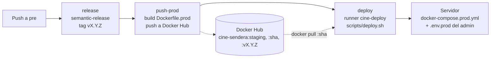
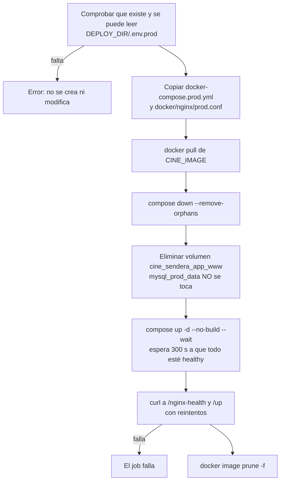

# Servidor personal (preproducción)

> **Navegación:** [README](../README.md) · [Entorno de desarrollo](./docker-entorno-desarrollo.md) · [CI/CD](./ci-cd.md) · [Producción simulada](./deployment-produccion.md) · **Servidor personal (preproducción)** · [Arquitectura del backend](./backend-architecture.md) · [Base de datos](./database-design.md)

Este documento cubre lo que es específico del servidor personal donde se despliega la rama `pre`: el runner, el directorio de despliegue, `scripts/deploy.sh`, el reinicio diario de la demo, la operación manual y la seguridad. La composición de contenedores es la de [deployment-produccion.md](./deployment-produccion.md); el pipeline completo (versionado con semantic-release, publicación de la imagen y orden de los jobs) está en [ci-cd.md](./ci-cd.md#workflow-preprodyml).

---

## Visión general del despliegue

Cada push a `pre` dispara el workflow `preprod.yml`. Los dos primeros jobs corren en runners de GitHub; el último, en el runner autoalojado del servidor.

El servidor usa **el mismo `docker-compose.prod.yml` del repositorio**: en `app`, `queue` y `scheduler` la imagen es `${CINE_IMAGE:-cine-sendera:prod}`. El despliegue define `CINE_IMAGE` con la imagen de Docker Hub y levanta con `--no-build`; en local, sin `CINE_IMAGE`, se construye `cine-sendera:prod`. Cualquier cambio del compose que llegue a `pre` se copia al servidor en el siguiente despliegue.

Se despliega el tag `:<sha>` (no `:staging`) para que cada despliegue sea reproducible y se sepa qué commit está corriendo.

---

## Requisitos del servidor

- Linux con Docker Engine y el plugin `docker compose` v2.20 o superior (usa `up --wait`).
- `curl` instalado.
- Puerto 80 libre y accesible.
- Un usuario dedicado (por ejemplo `github-runner`) que pertenezca al grupo `docker`.

---

## Configuración inicial (una sola vez)

### 1. Instalar el self-hosted runner

En GitHub: *Settings → Actions → Runners → New self-hosted runner* (Linux). Hay que seguir los comandos que muestra la página, ejecutándolos como el usuario dedicado, y registrar el runner con la etiqueta `cine-deploy` (`./config.sh --url <repo> --token <TOKEN> --labels cine-deploy`). Después se instala y arranca como servicio con `./svc.sh install <usuario>` y `./svc.sh start`.

### 2. Directorio de despliegue y `.env.prod`

`.env.prod` lo crea y mantiene **solo el administrador** del servidor, partiendo de `.env.prod.example`. El pipeline nunca lo genera ni lo modifica: únicamente lo lee. El directorio por defecto es `/opt/cine-sendera`; para usar otra ruta se define la variable de repositorio `DEPLOY_DIR`.

Permisos recomendados (`admin` es el usuario administrador y `github-runner` el del runner):

| Ruta | Dueño:grupo | Modo | Motivo |
| :--- | :--- | :--- | :--- |
| `/opt/cine-sendera/` | `admin:github-runner` | `1770` | Lectura/escritura para dueño y grupo; el sticky bit permite al runner crear sus archivos pero no borrar ni reemplazar los del administrador. |
| `/opt/cine-sendera/.env.prod` | `admin:github-runner` | `640` | El administrador lee y escribe, el runner solo lee, el resto nada. |
| `docker-compose.prod.yml`, `docker/nginx/prod.conf` | `github-runner` | `644` | Los copia el despliegue. |

En `.env.prod` hay que ajustar como mínimo las contraseñas de MySQL, una `APP_KEY` fija (si no, se genera una temporal en cada arranque e invalida las sesiones), `APP_URL` y `FRONTEND_URL`, y las credenciales `ADMIN_EMAIL` / `ADMIN_PASSWORD`. El detalle de cada variable está en [deployment-produccion.md](./deployment-produccion.md#primer-despliegue). Para obtener una clave se puede ejecutar `docker run --rm --entrypoint php <usuario>/cine-sendera:staging artisan key:generate --show`.

### 3. Secrets y variables en GitHub

| Nombre | Tipo | Uso |
| :--- | :--- | :--- |
| `DOCKERHUB_USERNAME` | secret | Usuario de Docker Hub (publicar y descargar la imagen) |
| `DOCKERHUB_TOKEN` | secret | Token de Docker Hub |
| `DEPLOY_DIR` | variable (opcional) | Ruta de despliegue en el servidor; por defecto `/opt/cine-sendera` |

El job `deploy` usa el environment `preprod`, que GitHub crea automáticamente. Opcionalmente se pueden añadir *required reviewers* para aprobar cada despliegue a mano. Los demás secretos del repositorio (`APP_KEY` de CI, `SONAR_TOKEN`, `CLAUDE_CODE_OAUTH_TOKEN`) se listan en [ci-cd.md](./ci-cd.md#secretos-y-variables).

---

## Qué hace `scripts/deploy.sh`

El script se ejecuta desde la raíz del checkout en el runner, con `CINE_IMAGE` (obligatoria) y `DEPLOY_DIR` como variables de entorno.

Notas: las migraciones y los seeders se ejecutan en el entrypoint de `app` durante el paso de `up --wait`; el proyecto Compose se llama `cine_sendera` (de ahí el volumen `cine_sendera_app_www`).

---

## Reinicio diario de la demo

La preproducción es una simulación: cada día a las 00:05 (hora de `DEMO_TIMEZONE`, por defecto `America/Mexico_City`) el contenedor `scheduler` ejecuta `php artisan demo:reset`, que:

1. Vacía `purchase_seats` y `purchases` (compras y boletos).
2. Devuelve a `open` las funciones `sold_out`.
3. Mueve cada función ya pasada a un día aleatorio entre mañana y dentro de 7 días, conservando la hora y evitando, si es posible, solapes en la misma sala.

Los usuarios registrados (con sus sesiones y tokens), las películas, las salas y las funciones se conservan. El administrador lo crean los seeders en cada arranque del contenedor `app` con `ADMIN_EMAIL` / `ADMIN_PASSWORD` de `.env.prod`.

El comando solo actúa con `DEMO_MODE=true` en `.env.prod`: sin esa variable el scheduler no lo programa y una ejecución manual termina con error sin borrar nada. Para ejecutarlo a mano: `docker exec cine_scheduler php artisan demo:reset`; para ver la programación: `docker exec cine_scheduler php artisan schedule:list`.

---

## Operación manual

Todos los comandos se ejecutan en `/opt/cine-sendera` (o en el `DEPLOY_DIR` elegido) con el prefijo `docker compose -p cine_sendera -f docker-compose.prod.yml`:

| Tarea | Subcomando |
| :--- | :--- |
| Estado y salud | `ps` |
| Logs de la app | `logs -f app` |
| Levantar a mano | `up -d --no-build --wait` (exportando antes `CINE_IMAGE`) |

Si se ejecuta `up` a mano hay que exportar `CINE_IMAGE` con el tag desplegado; sin ella Compose buscaría la imagen local `cine-sendera:prod`.

**Rollback:** la imagen de cada commit (`:<sha>`) sigue en Docker Hub. Desde un checkout del repositorio en el servidor se vuelve a ejecutar `scripts/deploy.sh` con `CINE_IMAGE=<usuario>/cine-sendera:<sha-anterior>` y `DEPLOY_DIR=/opt/cine-sendera`. Las migraciones **no** se revierten automáticamente.

---

## Seguridad

| Ámbito | Medida |
| :--- | :--- |
| Runner | Si el repositorio es público, activar en *Settings → Actions → General* **Require approval for all outside collaborators**, para que las PR de forks no ejecuten código en el servidor. Solo el job `deploy` (push a `pre`) usa este runner. |
| Docker | El usuario del runner pertenece al grupo `docker`, que equivale a `root`: no usar el runner para nada más. |
| `.env.prod` | Solo lo gestiona el administrador; el pipeline no lo escribe. Permisos `640` (tabla de la configuración inicial). Estos permisos evitan modificaciones accidentales del pipeline, no protegen frente a un runner comprometido. |
| Secretos | Credenciales de Docker Hub como *secrets* de GitHub; el job cierra sesión (`docker logout`) siempre al terminar. |
| Host | Según la configuración del servidor del equipo (no versionada en el repositorio): firewall UFW con solo los puertos 80 y 2222 abiertos y SSH endurecido con `PermitRootLogin no`. |
| Contenedores | Las medidas de red, cabeceras HTTP y límites de recursos de la pila están en [deployment-produccion.md](./deployment-produccion.md#seguridad). |
