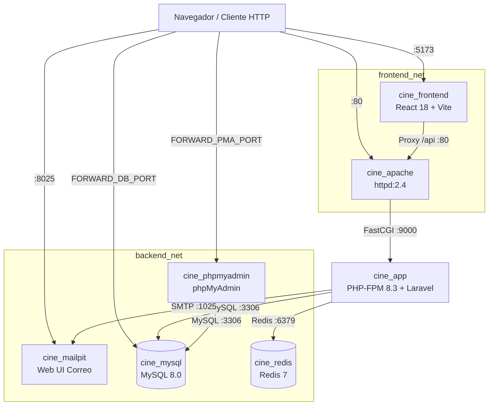
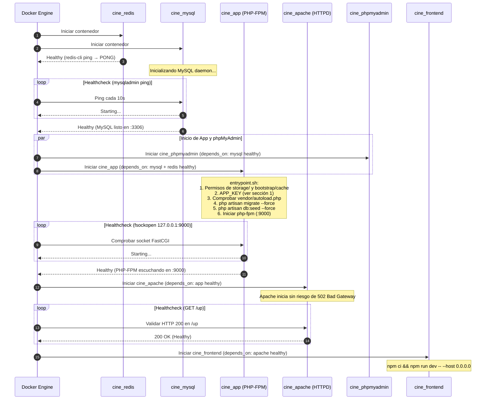

# Entorno de Desarrollo — Docker Compose, Orquestación y Variables

Este documento detalla la arquitectura de contenedores, la orquestación del orden de arranque con healthchecks (`feat/29-healthchecks-depends-on`) y la gestión centralizada de variables de entorno (`fix/28-docker-env-file`) para el entorno de desarrollo local de Cine Sendera.

---

## 1. Visión General de la Infraestructura de Desarrollo

El entorno de desarrollo emula una arquitectura LAMP moderna desacoplada en contenedores Docker bajo el principio de **un solo proceso por contenedor**:



`cine_app` es el único contenedor conectado a **ambas** redes (`frontend_net` y `backend_net`): Apache le reenvía peticiones FastCGI por `frontend_net` y Laravel accede a MySQL, Redis y Mailpit por `backend_net`. Así, ni Apache ni el frontend tienen ruta de red hacia la base de datos.

### Servicios en `docker-compose.yml`

| Servicio | Contenedor | Imagen / Base | Puerto Interno | Puerto Host | Redes | Responsabilidad Principal |
| :--- | :--- | :--- | :--- | :--- | :--- | :--- |
| `redis` | `cine_redis` | `redis:7-alpine` | `6379` | No expuesto al host | `backend_net` | Cache en memoria con volumen `redis_data`. |
| `app` | `cine_app` | `docker/php/Dockerfile` (PHP 8.3-FPM) | `9000` | No expuesto al host | `frontend_net`, `backend_net` | Ejecuta Laravel, procesa peticiones FastCGI, corre migraciones y seeders. |
| `apache` | `cine_apache` | `httpd:2.4` | `80` | `80:80` | `frontend_net` | Servidor web perimetral. Sirve estáticos y reenvía rutas dinámicas a `cine_app:9000`. |
| `mysql` | `cine_mysql` | `mysql:8.0` | `3306` | `${FORWARD_DB_PORT:-3306}:3306` | `backend_net` | Base de datos relacional con volumen persistente `mysql_data`. |
| `phpmyadmin` | `cine_phpmyadmin` | `phpmyadmin/phpmyadmin:5.2.3` | `80` | `${FORWARD_PMA_PORT:-8080}:80` | `backend_net` | Interfaz web de administración de base de datos. |
| `mailpit` | `cine_mailpit` | `axllent/mailpit:v1.31.4` | `1025` (SMTP), `8025` (UI) | `1025:1025`, `8025:8025` | `backend_net` | Servidor SMTP local para captura e inspección de emails generados por el sistema. |
| `frontend` | `cine_frontend` | `node:20-alpine` | `5173` | `5173:5173` | `frontend_net` | Servidor de desarrollo Vite con hot-reload (`npm ci && npm run dev`); `node_modules` en el volumen `frontend_node_modules`. |

### Primer arranque

```bash
# 1. Variables de entorno: el .env vive en la raíz (no en backend/)
cp .env.example .env
#    Ajustar HOST_UID / HOST_GID con `id -u` e `id -g`

# 2. Dependencias PHP (backend/vendor no está versionado; sin él el entrypoint aborta)
docker compose run --rm --no-deps --entrypoint sh app -c "composer install"

# 3. Generar la APP_KEY y pegarla en .env como APP_KEY=base64:...
docker compose run --rm --no-deps --entrypoint php app artisan key:generate --show

# 4. Levantar el stack
docker compose up -d
```

### Gestión de la `APP_KEY` en desarrollo

El `.env` de la raíz llega al contenedor `app` solo como variables de entorno (`env_file`); **no está montado como archivo** dentro de `/var/www` (que es `./backend`). Por eso `docker/php/entrypoint.sh` se comporta así:

1. Si `APP_KEY` tiene valor en el `.env` de la raíz, se usa tal cual.
2. Si está vacía y existe `backend/.env` con una `APP_KEY`, se usa esa.
3. Si está vacía y existe `backend/.env` sin clave, genera una y la escribe en `backend/.env`.
4. Si está vacía y **no** existe `backend/.env` (el caso normal en Docker), genera una clave **temporal en memoria** y la imprime en los logs:

   ```bash
   docker compose logs app | grep "APP_KEY="
   ```

   Esa clave cambia en cada reinicio del contenedor e invalida sesiones, cookies cifradas y cualquier dato cifrado con `encrypt()`. Hay que copiarla al `.env` de la raíz.

Después de editar `.env` hay que **recrear** el contenedor para que lea los nuevos valores; `docker compose restart` no recarga `env_file`:

```bash
docker compose up -d app
```

---

## 2. Gestión Centralizada de Variables de Entorno (`fix/28-docker-env-file`)

### 2.1 Problema Previo y Motivación
Anteriormente, el servicio `app` en `docker-compose.yml` declaraba explícitamente más de 40 variables de entorno bajo la directiva `environment:` (`APP_NAME: ${APP_NAME}`, `DB_HOST: ${DB_HOST}`, etc.). 

Esto generaba:
1. **Duplicación masiva y fragilidad:** Cada nueva variable requerida por Laravel obligaba a modificar simultáneamente `.env.example`, `.env` y `docker-compose.yml`.
2. **Riesgo de omisión y desincronización:** Variables agregadas en `.env` no eran transferidas al contenedor si se olvidaba registrarlas en Compose.
3. **Mantenimiento pesado:** Dificultad para auditar y depurar configuraciones.

### 2.2 Solución Implementada: Directiva `env_file`
Se refactorizó el servicio `app` para consumir directamente el archivo de configuración:

```yaml
services:
  app:
    # ...
    env_file:
      - .env
    # ...
```

Además, `environment: REDIS_HOST: redis` fuerza el host de Redis dentro del contenedor (los valores de `environment` tienen prioridad sobre `env_file`).

#### Ventajas:
- **Single Source of Truth:** `.env` es el único lugar donde se definen y ajustan los valores.
- **Inyección Transparente:** Todas las variables de entorno de Laravel (Sanctum, Cache, Queue, Mail, DB, AWS, etc.) quedan disponibles de forma automática para PHP-FPM y Artisan.
- **Limpieza del archivo de orquestación:** Reducción drástica de líneas redundantes en `docker-compose.yml`.

### 2.3 Mapeo Flexible de Puertos de Host (`FORWARD_*`)
Para evitar colisiones cuando un desarrollador ya tiene servicios locales corriendo en su máquina anfitriona (por ejemplo, otro MySQL en el puerto 3306 u otro servicio en el puerto 8080), se implementó parametrización con valores por defecto:

```yaml
services:
  mysql:
    ports:
      - "${FORWARD_DB_PORT:-3306}:3306"

  phpmyadmin:
    ports:
      - "${FORWARD_PMA_PORT:-8080}:80"
```

Configuración en `.env.example` / `.env`:
```env
# Puertos opcionales de host (para evitar colisiones locales)
FORWARD_DB_PORT=3308
FORWARD_PMA_PORT=8081
```

> **Nota arquitectónica:** La comunicación interna entre contenedores dentro de `frontend_net` / `backend_net` siempre usa los puertos estándar (`mysql:3306`, `app:9000`). Con los valores de `.env.example` MySQL queda en el puerto `3308` del host y phpMyAdmin en `8081`; si las variables no se definen se usan `3306` y `8080`. Los parámetros `FORWARD_*` afectan **únicamente** el acceso desde la máquina host (ej. desde DataGrip, DBeaver o el navegador).

### 2.4 Reglas Críticas del Parser de `env_file`
Docker Compose utiliza un parser estricto para archivos `.env`:
- **Comentarios:** Deben ir en su propia línea comenzando con `#` (ej. `# Configuración de BD`).
- **Prohibido comentarios en línea (inline comments):** Escribir `APP_KEY=base64:... # clave de app` provocará que Docker incluya `# clave de app` como parte literal del valor de la variable, rompiendo la aplicación con errores `500`.

---

## 3. Orquestación de Arranque y Healthchecks (`feat/29-healthchecks-depends-on`)

### 3.1 Problema Previo: Race Conditions al Iniciar el Stack
Un `depends_on` básico en Docker Compose solo espera a que el contenedor destino esté en estado de ejecución (*running*), no a que el proceso interno esté listo para recibir peticiones (*ready/healthy*).

Esto provocaba tres fallos intermitentes graves en arranques limpios (`docker compose up`):
1. **Fallo en Migraciones / Seeders:** El contenedor `cine_app` iniciaba de inmediato e intentaba ejecutar `php artisan migrate --seed` mientras `cine_mysql` aún estaba inicializando tablas del sistema y permisos, resultando en `SQLSTATE[HY000] [2002] Connection refused`.
2. **Error 502 Bad Gateway en Apache:** `cine_apache` arrancaba antes de que PHP-FPM abriera el puerto FastCGI `9000`, arrojando errores `Proxy Error: Could not connect to remote machine` o `FastCGI: unable to connect to server`.
3. **Pantallas de error en phpMyAdmin:** Intentos de conexión fallidos hacia MySQL durante el arranque.

### 3.2 Solución Implementada: Healthchecks y `service_healthy`

Se configuraron healthchecks nativos y dependencias condicionadas a la salud de los servicios:



### 3.3 Especificación Técnica de Healthchecks

#### 1. Base de Datos (`cine_mysql`)
```yaml
healthcheck:
  test: ["CMD", "mysqladmin", "ping", "-h", "localhost", "-u", "root", "-p$$MYSQL_ROOT_PASSWORD"]
  interval: 10s
  timeout: 5s
  retries: 5
  start_period: 30s
```
- **Mecanismo:** `mysqladmin ping` verifica que el motor InnoDB y el socket TCP de MySQL respondan a consultas autenticadas.
- **`start_period: 30s`:** Ventana de gracia para que MySQL realice la inicialización de archivos de datos sin marcar fallos prematuros.

#### 2. Servidor de Cache (`cine_redis`)
```yaml
healthcheck:
  test: ["CMD", "redis-cli", "ping"]
  interval: 10s
  timeout: 3s
  retries: 5
```
- **Mecanismo:** `redis-cli ping` comprueba que la instancia en memoria responda con `PONG`.

#### 3. Backend PHP-FPM (`cine_app`)
```yaml
healthcheck:
  test: ["CMD", "php", "-r", "$$fp = @fsockopen('127.0.0.1', 9000); exit($$fp ? 0 : 1);"]
  interval: 10s
  timeout: 5s
  retries: 5
  start_period: 30s
```
- **Mecanismo:** Script PHP inline que abre un socket TCP contra el puerto `9000` de PHP-FPM. Si la conexión es exitosa retorna `0` (Healthy); si falla retorna `1` (Unhealthy).
- **`start_period: 30s`:** Permite que `entrypoint.sh` ejecute las migraciones y seeders de la base de datos antes de que el healthcheck comience a evaluar el estado del servicio.
- **Dependencia de arranque:**
  ```yaml
  depends_on:
    redis:
      condition: service_healthy
    mysql:
      condition: service_healthy
  ```

#### 4. Servidor Web Apache (`cine_apache`)
```yaml
healthcheck:
  test: ["CMD-SHELL", "bash -c 'exec 3<>/dev/tcp/127.0.0.1/80 && printf \"GET /up HTTP/1.0\\r\\nHost: localhost\\r\\n\\r\\n\" >&3 && read -r line <&3 && [[ \"$$line\" =~ 200 ]]'"]
  interval: 10s
  timeout: 5s
  retries: 3
  start_period: 10s
```
- **Mecanismo:** Petición HTTP nativa usando descriptores de archivo y sockets Bash (`/dev/tcp`) solicitando el endpoint `/up` de Laravel (healthcheck endpoint) y verificando que la respuesta contenga el código de estado `200`.
- **Dependencia de arranque:**
  ```yaml
  depends_on:
    app:
      condition: service_healthy
  ```

#### 5. Interfaz phpMyAdmin (`cine_phpmyadmin`)
```yaml
depends_on:
  mysql:
    condition: service_healthy
```
- Garantiza que la interfaz web no intente levantar sesiones contra un motor MySQL no inicializado.

#### 6. Frontend Vite (`cine_frontend`)
```yaml
depends_on:
  apache:
    condition: service_healthy
```
- El proxy `/api` de Vite (`VITE_PROXY_TARGET=http://apache`) solo empieza a recibir tráfico cuando Apache ya responde `200` en `/up`.
- No define healthcheck propio.

#### 7. Correo (`cine_mailpit`)
- No define healthcheck en `docker-compose.yml`; el estado `healthy` que muestra `docker compose ps` proviene del `HEALTHCHECK` incluido en la imagen `axllent/mailpit`. Ningún servicio depende de él.

---

## 4. Guía de Operación y Comandos Útiles

### Iniciar el entorno completo
```bash
# Arrancar en segundo plano con control de dependencias
docker compose up -d

# Ver el estado detallado de salud de los contenedores
docker compose ps
```

Ejemplo de salida esperada:
```
NAME              IMAGE                         SERVICE      STATUS                   PORTS
cine_apache       httpd:2.4                     apache       Up 1 minute (healthy)    0.0.0.0:80->80/tcp
cine_app          cine_sendera-app              app          Up 1 minute (healthy)    9000/tcp
cine_frontend     node:20-alpine                frontend     Up 1 minute              0.0.0.0:5173->5173/tcp
cine_mailpit      axllent/mailpit:v1.31.4       mailpit      Up 1 minute (healthy)    0.0.0.0:1025->1025/tcp, 0.0.0.0:8025->8025/tcp
cine_mysql        mysql:8.0                     mysql        Up 1 minute (healthy)    0.0.0.0:3308->3306/tcp
cine_phpmyadmin   phpmyadmin/phpmyadmin:5.2.3   phpmyadmin   Up 1 minute              0.0.0.0:8081->80/tcp
cine_redis        redis:7-alpine                redis        Up 1 minute (healthy)    6379/tcp
```
(Puertos `3308` y `8081` con los valores de `.env.example`.)

### Inspección de Healthchecks
```bash
# Ver el último resultado del healthcheck de app
docker inspect --format='{{json .State.Health}}' cine_app

# Ver logs del entrypoint y de Laravel
docker compose logs -f app
```

### Reinicio y reconstrucción limpia
```bash
# Detener contenedores manteniendo volúmenes de datos
docker compose down

# Reconstruir imágenes tras cambios en Dockerfile o en docker/php/entrypoint.sh
# (el entrypoint se copia dentro de la imagen, no está montado)
docker compose up -d --build

# Aplicar cambios en .env (restart NO recarga env_file)
docker compose up -d
```

---

## 5. Resumen Técnico para Diapositivas / Presentaciones

Para la presentación del proyecto o diapositivas del equipo, los puntos clave a destacar son:

1. **Arquitectura desacoplada LAMP:** Separación estricta de Apache (servidor perimetral/estáticos) y PHP-FPM (procesamiento de lógica Laravel en worker pool).
2. **Centralización y Configuración Limpia (PR #28):**
   - Implementación de `env_file: .env` para eliminar redundancia de más de 40 variables en Compose.
   - Aislamiento de puertos de host mediante `FORWARD_DB_PORT` y `FORWARD_PMA_PORT` para prevenir colisiones en estaciones de trabajo de los desarrolladores.
3. **Orquestación Resiliente y Cero Race Conditions (PR #29):**
   - Implementación de healthchecks a nivel de base de datos (`mysqladmin ping`), aplicación (`fsockopen :9000`) y servidor web (`HTTP GET /up`).
   - Arranque determinista y ordenado con `depends_on: condition: service_healthy` (MySQL + Redis $\rightarrow$ App $\rightarrow$ Apache $\rightarrow$ Frontend), eliminando por completo los errores `502 Bad Gateway` y fallos en migraciones automáticas.
4. **Segmentación de red:**
   - `frontend_net` (frontend, Apache, app) y `backend_net` (app, MySQL, Redis, phpMyAdmin, Mailpit); `app` es el único puente entre ambas, así que la base de datos no es alcanzable desde Apache ni desde el frontend.
