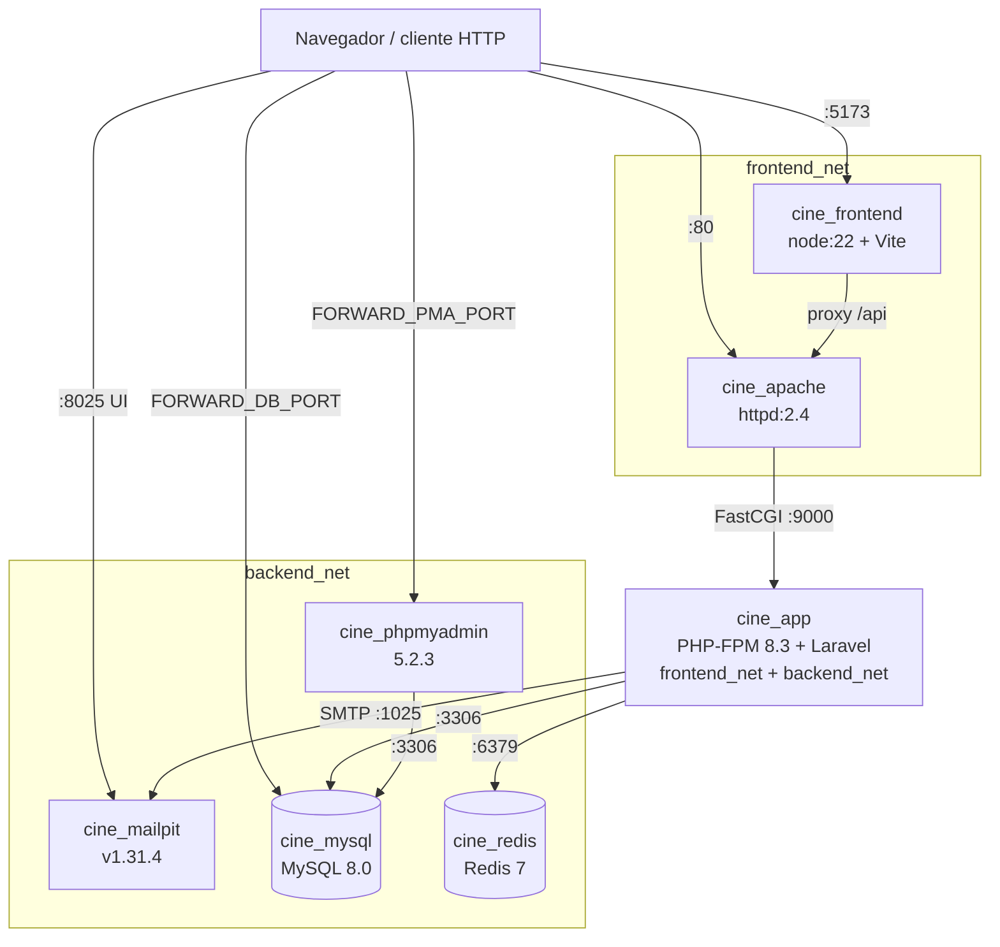
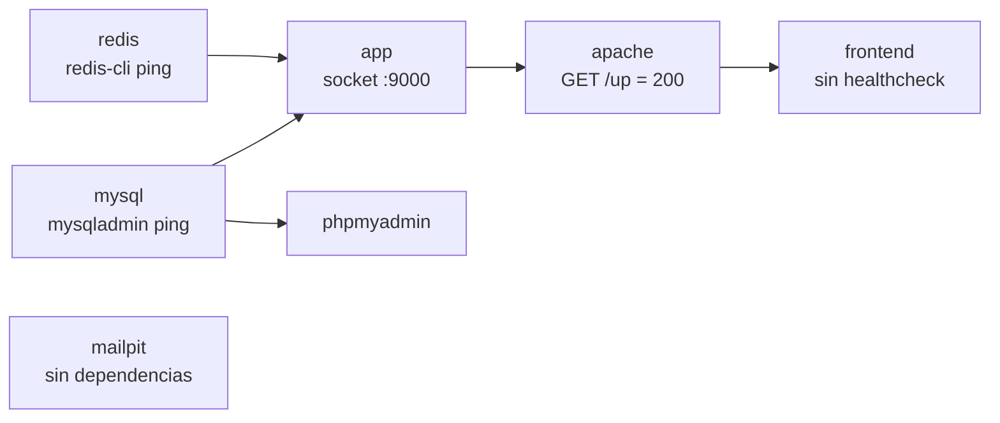
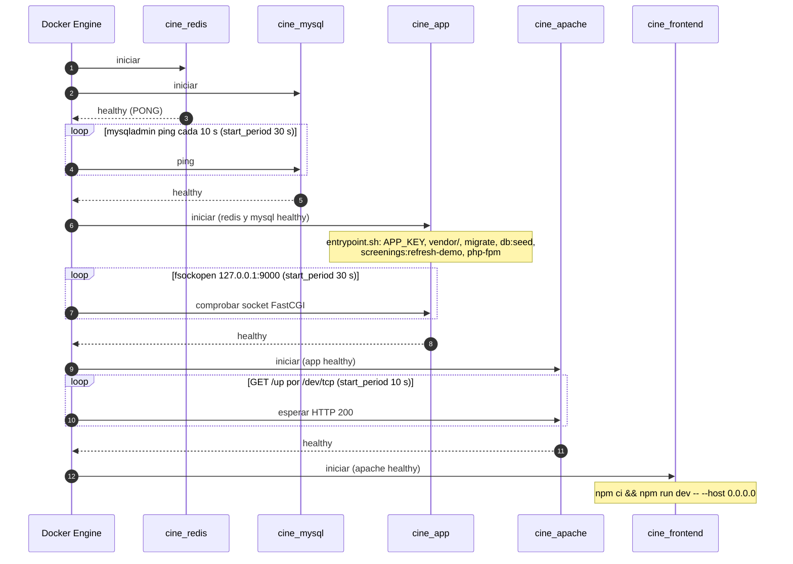

# Entorno de desarrollo (Docker Compose)

> **Navegación:** [README](../README.md) · **Entorno de desarrollo** · [CI/CD](./ci-cd.md) · [Producción simulada](./deployment-produccion.md) · [Servidor personal (preproducción)](./deployment-servidor-personal.md) · [Arquitectura del backend](./backend-architecture.md) · [Base de datos](./database-design.md)

Este documento es la referencia técnica del entorno local definido en `docker-compose.yml`: inicio rápido, topología de contenedores y redes, orden de arranque con healthchecks, variables de entorno y comandos de desarrollo. El entorno de producción simulada se describe en [deployment-produccion.md](./deployment-produccion.md) y los workflows de GitHub en [ci-cd.md](./ci-cd.md).

---

## 1. Inicio rápido

Requisitos: Docker Engine y Docker Compose v2. No hace falta Node ni PHP en el host: el frontend corre en el contenedor `cine_frontend` y Composer se ejecuta dentro de `app`.

```bash
# 1. Variables de entorno: el .env vive en la RAÍZ del proyecto (no en backend/)
cp .env.example .env
#    Ajustar HOST_UID / HOST_GID con los valores de `id -u` e `id -g`

# 2. Dependencias PHP (backend/vendor no se versiona; sin él el entrypoint aborta)
docker compose run --rm --no-deps --entrypoint sh app -c "composer install"

# 3. (Opcional) generar la APP_KEY y pegarla en .env como APP_KEY=base64:...
docker compose run --rm --no-deps --entrypoint php app artisan key:generate --show

# 4. Levantar todos los servicios (incluye el frontend Vite con hot-reload)
docker compose up -d
```

El entrypoint de `app` ejecuta migraciones, seeders y el reagendado de funciones demo en cada arranque (ver [sección 4](#4-orden-de-arranque-y-healthchecks)). La primera vez, el frontend tarda unos minutos porque ejecuta `npm ci`.

### Servicios y puertos expuestos al host

| Servicio | URL / puerto en el host |
| :--- | :--- |
| App (API y SPA servida por Apache) | `http://localhost` (puerto `80`) |
| Frontend con hot-reload (Vite) | `http://localhost:5173` |
| phpMyAdmin | `http://localhost:${FORWARD_PMA_PORT}` (`8081` con `.env.example`; `8080` si no se define) |
| MySQL (DataGrip, DBeaver...) | `localhost:${FORWARD_DB_PORT}` (`3308` con `.env.example`; `3306` si no se define) |
| Mailpit (interfaz web) | `http://localhost:8025` (SMTP en `:1025`) |

Redis y PHP-FPM (`:9000`) no se publican en el host.

---

## 2. Topología de contenedores y redes

El entorno sigue el principio de **un proceso por contenedor**. Hay dos redes y `cine_app` es el único contenedor conectado a ambas: Apache le reenvía las peticiones FastCGI por `frontend_net` y Laravel accede a MySQL, Redis y Mailpit por `backend_net`. Así, ni Apache ni el frontend tienen ruta de red hacia la base de datos.



### Servicios de `docker-compose.yml`

| Servicio | Contenedor | Imagen | Redes | Responsabilidad |
| :--- | :--- | :--- | :--- | :--- |
| `redis` | `cine_redis` | `redis:7-alpine` | `backend_net` | Caché en memoria (`CACHE_STORE=redis`); volumen `redis_data`. |
| `mysql` | `cine_mysql` | `mysql:8.0` | `backend_net` | Base de datos; volumen `mysql_data`. |
| `app` | `cine_app` | `docker/php/Dockerfile` (PHP 8.3.36-FPM) | `frontend_net`, `backend_net` | Ejecuta Laravel, migraciones y seeders. Código en bind mount `./backend`. |
| `apache` | `cine_apache` | `httpd:2.4` | `frontend_net` | Servidor web; configuración en `docker/apache/000-default.conf`; reenvía `.php` a `app:9000`. |
| `phpmyadmin` | `cine_phpmyadmin` | `phpmyadmin/phpmyadmin:5.2.3` | `backend_net` | Administración web de la base de datos. |
| `mailpit` | `cine_mailpit` | `axllent/mailpit:v1.31.4` | `backend_net` | Captura los correos salientes (SMTP `:1025`, UI `:8025`). |
| `frontend` | `cine_frontend` | `node:22-alpine` | `frontend_net` | Vite con hot-reload (`npm ci && npm run dev`); `node_modules` en el volumen `frontend_node_modules`; proxy `/api` hacia `http://apache` (`VITE_PROXY_TARGET`). |

Diferencias con producción simulada (nginx, queue, scheduler, redes DMZ, código dentro de la imagen): ver la [tabla comparativa](./deployment-produccion.md#diferencias-con-el-entorno-de-desarrollo).

### Particularidades del servicio `app`

| Aspecto | Detalle |
| :--- | :--- |
| Usuario | `www-data`, remapeado al `HOST_UID`/`HOST_GID` del host (argumentos de build) para no crear archivos de `root` en `./backend`. |
| Volúmenes | `./backend:/var/www`, `./.env:/var/www/.env` (lo monta como archivo) y `docker/php/php-dev.ini` (OPcache desactivado). |
| Variables | `env_file: .env` más `REDIS_HOST=redis`, que tiene prioridad sobre el archivo. |
| Cola y scheduler | No hay contenedores `queue` ni `scheduler` en desarrollo (`QUEUE_CONNECTION=database`; el worker solo existe en producción simulada, o con `composer dev` fuera de Docker). |

---

## 3. Variables de entorno

### 3.1 Un único `.env` en la raíz

El servicio `app` consume el `.env` de la raíz con `env_file: .env`, en lugar de declarar variable por variable bajo `environment:`. Así `.env` es la única fuente de verdad y cualquier variable nueva de Laravel llega al contenedor sin tocar `docker-compose.yml`. `mysql` y `phpmyadmin` reciben `DB_*`, `MYSQL_ROOT_PASSWORD` y `DB_HOST` por interpolación de Compose desde el mismo archivo. No existe `backend/.env` en Docker.

### 3.2 Puertos de host (`FORWARD_*`)

Para evitar colisiones con servicios locales del desarrollador, el puerto publicado de MySQL y de phpMyAdmin se parametriza con `FORWARD_DB_PORT` y `FORWARD_PMA_PORT` (valores por defecto `3306` y `8080`; `.env.example` usa `3308` y `8081`). Afectan **solo** al acceso desde el host; entre contenedores se usan siempre los puertos estándar (`mysql:3306`, `app:9000`).

### 3.3 Reglas del parser de `env_file`

| Regla | Motivo |
| :--- | :--- |
| Los comentarios van en su propia línea, empezando por `#`. | Compose no admite comentarios en línea. |
| Nunca `APP_KEY=base64:... # texto`. | El texto del comentario pasa a formar parte del valor y la app responde `500`. |
| Tras editar `.env`, recrear con `docker compose up -d`. | `docker compose restart` no recarga `env_file`. |

### 3.4 Gestión de la `APP_KEY`

Como `./.env` está montado en `/var/www/.env`, `docker/php/entrypoint.sh` resuelve la clave en este orden:

| Caso | Comportamiento |
| :--- | :--- |
| `APP_KEY` tiene valor en el entorno del contenedor | Se usa tal cual. |
| Está vacía pero `.env` (montado) contiene una `APP_KEY` | Se exporta esa clave. |
| Está vacía y `.env` no tiene clave | Ejecuta `php artisan key:generate --force`, que la escribe en el `.env` montado; queda persistida en el host. |

Si se deja vacía en el `.env` de la raíz, la clave generada aparece en el archivo tras el primer arranque. Cambiarla invalida sesiones, cookies cifradas y todo lo cifrado con `encrypt()`.

---

## 4. Orden de arranque y healthchecks

Un `depends_on` simple solo espera a que el contenedor esté *running*, no a que el proceso esté listo. Eso causaba migraciones fallidas (`Connection refused` contra un MySQL aún inicializando), `502 Bad Gateway` en Apache (PHP-FPM sin escuchar todavía) y errores de phpMyAdmin. Por eso cada dependencia usa `condition: service_healthy`.





### Especificación de los healthchecks

| Servicio | Comprobación | Intervalo / reintentos | `start_period` | Depende de |
| :--- | :--- | :--- | :--- | :--- |
| `mysql` | `mysqladmin ping` con el usuario root | 10 s / 5 | 30 s | - |
| `redis` | `redis-cli ping` (responde `PONG`) | 10 s / 5 | - | - |
| `app` | Script PHP que abre un socket a `127.0.0.1:9000` | 10 s / 5 | 30 s (cubre migraciones y seeders del entrypoint) | `redis` y `mysql` healthy |
| `apache` | `GET /up` con sockets Bash (`/dev/tcp`), exige código `200` | 10 s / 3 | 10 s | `app` healthy |
| `phpmyadmin` | Sin healthcheck | - | - | `mysql` healthy |
| `frontend` | Sin healthcheck; el proxy `/api` de Vite solo recibe tráfico con Apache sano | - | - | `apache` healthy |
| `mailpit` | Sin definición en Compose; el estado `healthy` viene del `HEALTHCHECK` de la imagen | - | - | - |

### Pasos del entrypoint de `app`

| Orden | Acción |
| :--- | :--- |
| 1 | Resolver `APP_KEY` ([sección 3.4](#34-gestión-de-la-app_key)). |
| 2 | Abortar si falta `vendor/autoload.php` (hay que ejecutar `composer install`). |
| 3 | `php artisan migrate --force`. |
| 4 | `php artisan db:seed --force` (el administrador sale de `ADMIN_EMAIL`/`ADMIN_PASSWORD`; vacíos en desarrollo = `test@example.com` / `password`). |
| 5 | `php artisan screenings:refresh-demo`, que reagenda las funciones demo ya pasadas. |
| 6 | `exec php-fpm`. |

El entrypoint se copia dentro de la imagen: tras editar `docker/php/entrypoint.sh` hay que reconstruir con `--build`.

---

## 5. Comandos de desarrollo

### Operación del stack

```bash
# Levantar en segundo plano / ver estado y salud
docker compose up -d
docker compose ps

# Logs de la app (entrypoint y PHP-FPM) o de cualquier servicio
docker compose logs -f app

# Último resultado del healthcheck de app
docker inspect --format='{{json .State.Health}}' cine_app

# Aplicar cambios en .env (restart NO recarga env_file)
docker compose up -d

# Reconstruir tras cambios en el Dockerfile o en docker/php/entrypoint.sh
docker compose up -d --build

# Detener conservando volúmenes / detener y borrar datos (MySQL y Redis)
docker compose down
docker compose down -v
```

### Backend (dentro del contenedor `app`)

```bash
docker compose exec app php artisan test                 # suite completa (SQLite en memoria)
docker compose exec app php artisan test --filter X      # filtrar por nombre
docker compose exec app ./vendor/bin/pint                # linting (Laravel Pint)
docker compose exec app php artisan migrate:fresh --seed # reiniciar la base de datos
docker compose exec app php artisan tinker
```

### Frontend

```bash
# Dentro del contenedor (Vite ya corre con `docker compose up -d`)
docker compose exec frontend npm run lint
docker compose exec frontend npm run test      # Vitest
docker compose exec frontend npm run build     # build de producción

# Alternativa local, con Node en el host
cd frontend && npm install && npm run dev
```

Los tests de extremo a extremo (`npm run test:e2e`, Playwright) se ejecutan en CI contra el stack de producción simulada; ver [ci-cd.md](./ci-cd.md#job-prod-e2e).

### Logs de Laravel

Con `LOG_CHANNEL=stack` y `LOG_STACK=single`, Laravel escribe en `backend/storage/logs/laravel.log`, visible en el host por el bind mount. Si `backend/storage` quedó con propietario `root`, corregirlo con `sudo chown -R $USER:$USER backend/storage backend/bootstrap/cache backend/vendor`.

### Salida esperada de `docker compose ps`

Con los valores de `.env.example`, todos los servicios con healthcheck deben pasar a `healthy` (`redis`, `mysql`, `app`, `apache` y `mailpit`); `phpmyadmin` y `frontend` muestran `Up`. MySQL aparece publicado como `3308->3306` y phpMyAdmin como `8081->80`.
