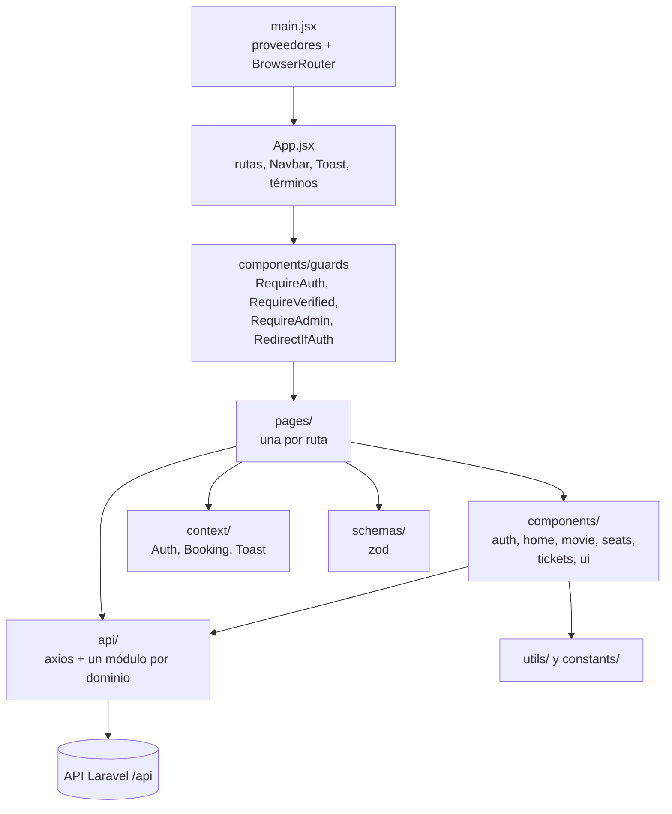
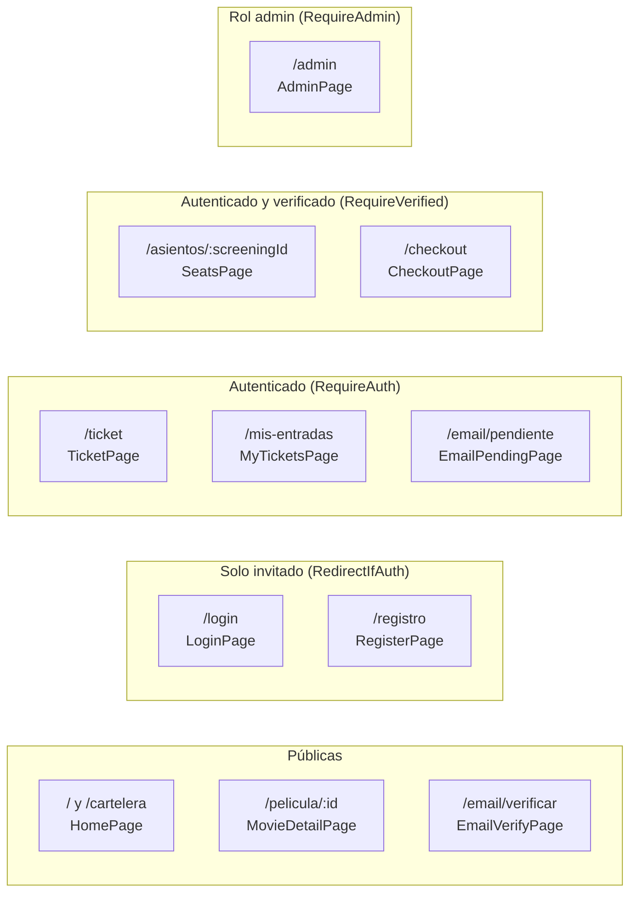
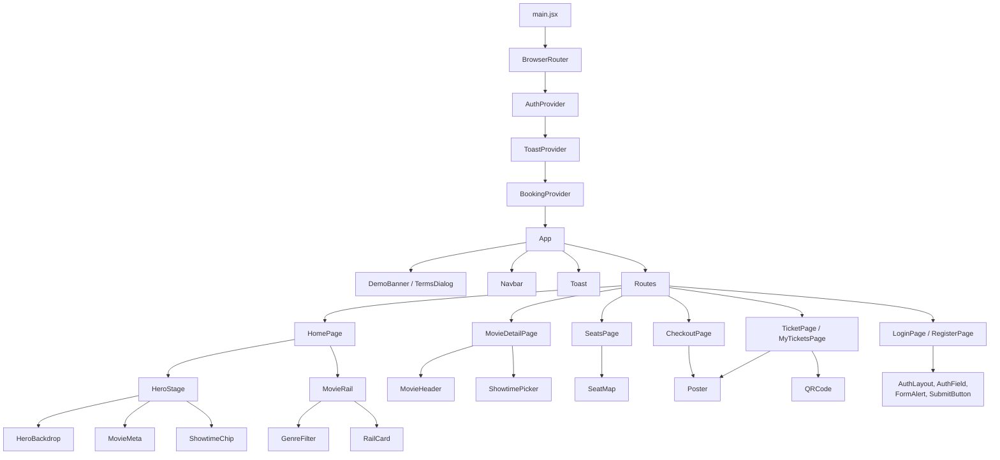
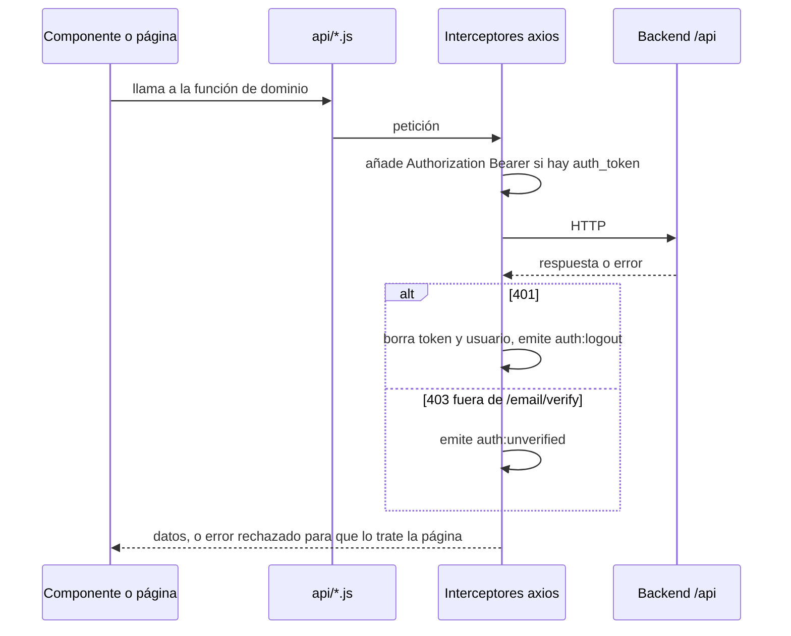
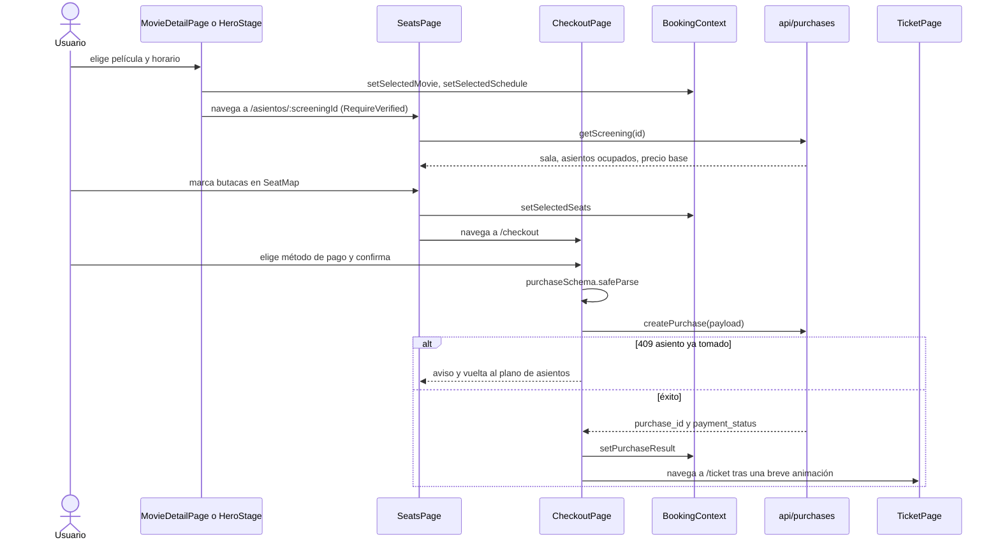

# Arquitectura del frontend — Cine Sendera

SPA de React 19 servida por Vite. No hay lógica de negocio en el cliente: el precio, la disponibilidad y los estados de pago los decide el backend (ver [reglas-de-negocio.md](reglas-de-negocio.md)). Índice general en [frontend/README.md](../frontend/README.md).

## 1. Estructura de `frontend/src`

| Carpeta | Contenido |
|---|---|
| `api/` | Cliente axios compartido (`axios.js`) y funciones por dominio: `auth`, `movies`, `purchases`, `admin` |
| `components/guards/` | Guards de ruta usados por `App.jsx` |
| `components/auth/` | `AuthLayout`, `AuthField`, `FormAlert`, `SubmitButton` (login y registro) |
| `components/home/` | `HeroStage`, `HeroBackdrop`, `MovieRail`, `RailCard`, `GenreFilter`, `MovieMeta`, `ShowtimeChip` |
| `components/movie/` | `MovieHeader`, `ShowtimePicker` y `showtimes.js` (agrupación de funciones) |
| `components/seats/` | `SeatMap` y `seatLook.js` (clases por estado de butaca) |
| `components/tickets/` | `Poster` y `tickets.js` (formato de asientos, dinero y orden) |
| `components/ui/` | Piezas atómicas: `PillButton`, `Spinner`, `Toast`, `BtnPrimary`, `BtnSecondary`, `icons.jsx` |
| `components/` (raíz) | `Navbar`, `DemoBanner`, `TermsDialog`, `QRCode` |
| `context/` | Estado global con Context API |
| `schemas/` | Esquemas zod y el agrupador de errores por campo |
| `utils/` | `format.js`, `images.js` (URLs de imagen y hora de función), `simulationNotice.js` (términos y banner) |
| `constants/` | `theme.js` y `mockData.js`, solo para vistas sin migrar |

Código heredado: `Cine.jsx`, `components/AuthGuard.jsx` y `components/VerifiedGuard.jsx` pertenecen a la antigua navegación por estado (`setPage`) y no se usan desde `main.jsx` ni `App.jsx`. Los guards vigentes son los de `components/guards/`.

## 2. Mapa de rutas y guards

`App.jsx` define todas las rutas con `react-router-dom`. Las URL están en español; cualquier ruta desconocida redirige a `/`.

| Guard | Sin sesión | Otra condición que falla |
|---|---|---|
| `RequireAuth` | Redirige a `/login` guardando la ruta de origen en `state.from` | No aplica |
| `RequireVerified` | Redirige a `/login` con `state.from` | `user.verified === false` redirige a `/email/pendiente` |
| `RequireAdmin` | Redirige a `/login` | `user.role !== "admin"` redirige a `/` |
| `RedirectIfAuth` | Muestra la página | Con sesión redirige a `/` |

Mientras `AuthContext` carga el usuario desde `localStorage`, los guards (salvo `RequireAdmin`) devuelven `null` para evitar parpadeos. Los guards solo protegen la navegación: la autorización real la aplica el backend.

El cliente reacciona además a dos eventos de `window` que emite el interceptor de axios: `auth:logout` (limpia sesión y va a `/login`) y `auth:unverified` (va a `/email/pendiente`).

## 3. Jerarquía de componentes

## 4. Contextos y estado

No hay Redux ni librería de datos: el estado compartido son tres contextos y cada página gestiona su carga con estado local.

| Contexto | Hook | Estado que guarda | Persistencia |
|---|---|---|---|
| `AuthContext` | `useAuth` | `user`, `loading`; acciones `saveAuth`, `clearAuth`, `updateUser` | `localStorage`: `auth_token` y `auth_user` |
| `BookingContext` | `useBooking` | `selectedMovie`, `selectedSchedule`, `selectedSeats`, `purchaseResult` | Solo memoria; se pierde al recargar |
| `ToastContext` | `useToast` | Lista de avisos; `addToast(mensaje, tipo)` los retira a los 3,2 s | Ninguna |

El consentimiento de términos y el cierre del banner de demostración se guardan aparte con `utils/simulationNotice.js`, siempre dentro de `try/catch` por si el navegador bloquea el almacenamiento.

## 5. Capa `api/` y flujo de datos

Todas las llamadas pasan por la instancia de `api/axios.js` (`baseURL` `/api`, JSON). Las funciones de `movies`, `purchases` y `admin` devuelven `response.data`; las de `auth.js` devuelven la respuesta completa porque el llamador necesita `data.user` y `data.token`.

| Módulo | Funciones |
|---|---|
| `auth.js` | `register`, `login`, `logout`, `resendVerification`, `verifyEmail` |
| `movies.js` | `getMovies`, `getMovie` |
| `purchases.js` | `getScreening`, `createPurchase`, `getMyTickets`, `getTicket` |
| `admin.js` | `getAdminMetrics`, `getAdminActivity`, `getAdminRooms`, `getAdminSystem` |

Los contratos de cada endpoint están en [api-endpoints.md](api-endpoints.md). En desarrollo Vite redirige `/api` a `VITE_PROXY_TARGET`; en producción Apache sirve SPA y API en el mismo origen, por eso la base es relativa.

## 6. Validación con zod

Los esquemas de `schemas/` replican en el cliente las reglas de los Form Requests del backend para dar respuesta inmediata; el backend sigue siendo la fuente de verdad. Los mensajes están en español.

| Esquema | Archivo | Se usa en | Valida |
|---|---|---|---|
| `loginSchema` | `auth.schemas.js` | `LoginPage` | Correo con formato y hasta 255 caracteres; contraseña obligatoria de hasta 72 |
| `registerSchema` | `auth.schemas.js` | `RegisterPage` | Nombre de 2 a 255 caracteres no vacío; correo; contraseña de 8 a 72; confirmación idéntica |
| `purchaseSchema` | `purchase.schemas.js` | `CheckoutPage` | `screening_id` entero positivo; al menos un asiento con fila de una letra y número de 1 a 30; `payment_method` entre `cash`, `card` y `online` |

`fieldErrors.js` convierte un `ZodError` en un mapa campo a lista de mensajes para mostrarlos junto a cada campo. `CheckoutPage`, que no tiene campos de texto, une los mensajes en un aviso (toast).

## 7. Flujo de compra en el cliente

Rutas, guards y contexto entre elegir función y ver el comprobante. El detalle funcional está en [modulos/03-compras.md](modulos/03-compras.md).

`CheckoutPage` calcula el total mostrado como cantidad de asientos por `base_price` solo para informar; el importe cobrado lo fija el backend. Si no hay asientos en `BookingContext` (por ejemplo tras recargar), la página ofrece volver a la selección.

## 8. Pruebas

| Tipo | Herramienta | Ubicación | Ejecución |
|---|---|---|---|
| Unitarias y de componente | Vitest, jsdom, Testing Library | `__tests__/` junto al código (`components`, `context`, `pages`, `schemas`) | `npm run test` |
| Cobertura | `@vitest/coverage-v8` | Informe `text`, `lcov` y `html` | `npm run test:coverage`; umbral del 60 % en líneas, funciones, ramas y sentencias |
| Extremo a extremo | Playwright (Chromium) | `tests/e2e`: `auth`, `cartelera`, `compra`, `admin` | `npm run test:e2e` |

- `tests/helpers/render-with-providers.tsx` monta proveedores y router para las pruebas de página; `tests/fixtures/users.ts` aporta usuarios de prueba.
- La configuración de Playwright precarga la aceptación de términos en `localStorage` para que el diálogo de consentimiento no bloquee los flujos.
- La integración continua ejecuta `build` y `test` en el job `test-frontend`, y Playwright en `prod-e2e` (ver `.github/workflows/ci.yml`).

## 9. Compilación y entorno

| Aspecto | Comportamiento (de `vite.config.js`) |
|---|---|
| Salida | `backend/public/build`, vaciada en cada build |
| `base` | `/build/` en producción para que Apache resuelva los assets; `/` en desarrollo |
| Servidor de desarrollo | `host: true` y sondeo de archivos para que la recarga funcione dentro de Docker |
| Proxy | `/api` hacia `VITE_PROXY_TARGET` |
| Variables | `envDir` apunta a la raíz del repositorio |
| Plugins | `@vitejs/plugin-react` y `@tailwindcss/vite` |
