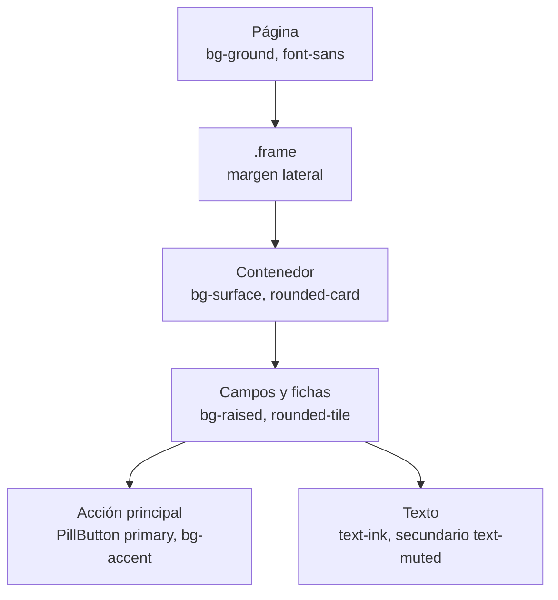
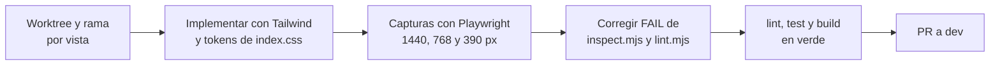

# Sistema de diseño del frontend — Cine Sendera

Fuente de verdad: el bloque `@theme` de `frontend/src/index.css`. Este documento describe los tokens y componentes que existen hoy; la estructura de carpetas, rutas y estado está en [frontend-architecture.md](frontend-architecture.md).

## 1. Estándares

| Ámbito | Idioma |
|---|---|
| Código (variables, funciones, componentes, archivos) | Inglés |
| Contenido visible para el usuario | Español |
| Documentación | Español |

Reglas de interfaz obligatorias (detalle en `CLAUDE.md`):

- Responsive desde 320 px, sin anchos ni alturas fijas que rompan en pantallas pequeñas; se prueba en escritorio y en 480 px o menos.
- Sin emoji. Los iconos nuevos se importan de `lucide-react` con sus valores por defecto (solo `size` y color por clase). Los iconos dibujados a mano de `components/ui/icons.jsx`, `Navbar`, `HeroStage` y `AdminPage` se conservan hasta que esa vista se rediseñe.

## 2. Estado de migración

El sistema convive con estilos heredados. Los tokens de `@theme` son la referencia; `constants/theme.js` (paleta anterior, roja `#E50914` sobre carbón `#221F1F`) solo sigue vigente donde la vista no se ha migrado.

| Estilo | Vistas y componentes |
|---|---|
| Tailwind con tokens de `@theme` | `HomePage` y `components/home`, `LoginPage`, `RegisterPage` y `components/auth`, `MovieDetailPage` y `components/movie`, `SeatsPage` y `components/seats`, `CheckoutPage`, `TicketPage`, `MyTicketsPage`, `EmailPendingPage`, `EmailVerifyPage`, `Navbar`, `DemoBanner`, `PillButton` |
| Heredado (`constants/theme.js`) | `AdminPage`, `TermsDialog`, `ui/BtnPrimary`, `ui/BtnSecondary`, `ui/Spinner`, `ui/Toast`, y el bloque de fuentes que inyecta `App.jsx` |

Los componentes heredados no deben copiarse en vistas nuevas.

## 3. Tokens de color

Tema oscuro único. Cada token genera utilidades de Tailwind (`bg-ground`, `text-muted`, `border-accent`, etc.).

| Token | Valor | Uso |
|---|---|---|
| `ground` | `#0b0b0d` | Fondo de página |
| `surface` | `#16161a` | Tarjetas y paneles |
| `raised` | `#212127` | Elementos elevados y fondo de campos de formulario |
| `ink` | `#ffffff` | Texto principal |
| `muted` | `#b4b4bd` | Texto secundario y metadatos |
| `accent` | `#d6263d` | Acción principal, butaca seleccionada, error de campo |
| `accent-strong` | `#bb1d32` | Estado hover del acento |
| `warning` | `#f5b014` | Avisos y estados pendientes |

Transparencias del blanco (`white/10`, `white/25`) se usan para botones fantasma y butacas; no son tokens propios.

## 4. Tipografía

| Token | Pila | Uso |
|---|---|---|
| `font-sans` | Montserrat, Open Sans, `system-ui`, sans-serif | Texto general |
| `font-display` | Montserrat, Open Sans, `system-ui`, sans-serif | Títulos |

Las fuentes se cargan desde Google Fonts mediante el bloque `FONTS` de `constants/theme.js`, inyectado por `App.jsx`. Reglas de la guía de arte vigentes: sin monoespaciada, sin numeración decorativa, sin sobretítulos y sin degradados decorativos (un velo sobre una fotografía sí se admite).

## 5. Radios, espaciado y animaciones

| Token o clase | Valor | Uso |
|---|---|---|
| `rounded-card` | `1.75rem` | Tarjetas y paneles grandes |
| `rounded-tile` | `1rem` | Campos, fichas y mosaicos |
| `animate-rise` | `rise` 0,55 s | Entrada con desplazamiento vertical |
| `animate-fill` | `fill` 0,8 s | Barra de avance hacia el comprobante; debe durar lo mismo que `REDIRECT_DELAY_MS` de `CheckoutPage` |
| `.frame` | Margen lateral 1,25 rem; 1,5 rem desde 768 px; 2,5 rem desde 1024 px | Marco lateral único de las vistas |
| `.no-scrollbar` | Oculta la barra de desplazamiento | Carriles horizontales de películas |

Puntos de corte: los estándar de Tailwind; el diseño parte de móvil y amplía con `md` y `lg`.

## 6. Componentes de UI

### Botones

| Componente | Variantes y tamaños | Notas |
|---|---|---|
| `ui/PillButton` | `primary` (acento), `ghost` (blanco translúcido), `light` (blanco); tamaños `md` y `lg` | Forma de píldora; con la prop `as` se renderiza como enlace; foco visible y deshabilitado atenuado. Es el botón de las vistas rediseñadas |
| `auth/SubmitButton` | Botón de envío con estado de carga | Formularios de login y registro |
| `ui/BtnPrimary`, `ui/BtnSecondary` | Heredados | Solo `AdminPage` y diálogos antiguos |

### Campos de formulario

| Clase | Función |
|---|---|
| `.field-label` | Etiqueta encima del campo |
| `.field-input` | Campo de 3,25 rem de alto sobre `raised`; foco con borde blanco; `aria-invalid="true"` pinta el borde en `accent` |
| `.field-input--action` | Reserva espacio a la derecha para un botón dentro del campo |

`auth/AuthField` encapsula etiqueta, campo y mensaje de error; `auth/FormAlert` muestra el error general del formulario y `auth/AuthLayout` da el marco de las pantallas de acceso.

### Cartelera y detalle

| Componente | Rol |
|---|---|
| `home/HeroStage` y `HeroBackdrop` | Película destacada con fondo apaisado y velo |
| `home/MovieRail`, `RailCard`, `GenreFilter` | Carril horizontal de películas con filtro por género |
| `home/ShowtimeChip`, `MovieMeta` | Chip de horario y metadatos (duración, género) |
| `movie/MovieHeader`, `ShowtimePicker` | Cabecera del detalle y selector de funciones agrupadas |

### Selector de asientos

`seats/SeatMap` dibuja el plano y `seats/seatLook.js` define el aspecto por estado; plano y leyenda comparten esas clases para que cada muestra de la leyenda sea la butaca misma.

| Estado | Aspecto |
|---|---|
| `free` | Blanco translúcido al 25 %, más claro al pasar el cursor |
| `selected` | Fondo `accent`, texto `ink`, `accent-strong` en hover |
| `occupied` | Blanco al 7 %, texto atenuado y cursor de no permitido |

### Avisos, diálogos y comprobantes

| Componente | Rol |
|---|---|
| `ui/Toast` | Avisos temporales (`success`, `error`, `info`) alimentados por `ToastContext` |
| `ui/Spinner` | Indicador de carga |
| `TermsDialog` | Consentimiento inicial de términos y revisión posterior |
| `DemoBanner` | Aviso de modo demostración con enlace al buzón de pruebas |
| `tickets/Poster` | Cartel en miniatura de checkout, ticket y mis entradas |
| `QRCode` | Código QR del `ticket_code` con `qrcode.react` |

## 7. Jerarquía visual de una vista

## 8. Flujo de rediseño de una vista

Se rediseña una vista por vez, cada una en su worktree y rama `feat/redesign-<vista>` (flujo Git en `CLAUDE.md`). Los pasos de calidad:

- Los componentes compartidos nuevos van en su propia PR antes de la vista que los use.
- La guía de arte es el skill `design-taste-frontend` (`.agents/skills/design-taste-frontend/SKILL.md`); si el usuario aporta una imagen de referencia, esa imagen manda.
- Los colores, fuentes y radios se declaran una sola vez en `@theme`; no se usan objetos `style` en línea ni bloques `<style>` por componente.

## 9. Tecnologías de interfaz

| Necesidad | Solución |
|---|---|
| Framework | React 19, JavaScript (sin TypeScript en `src/`; los tests sí usan TS) |
| Estilos | Tailwind CSS v4 con `@tailwindcss/vite` |
| Iconos | `lucide-react` |
| QR | `qrcode.react` |

Datos, rutas y flujo de compra del cliente: [frontend-architecture.md](frontend-architecture.md). Contratos de la API: [api-endpoints.md](api-endpoints.md).
