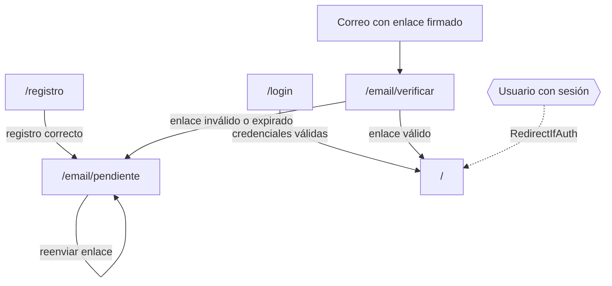
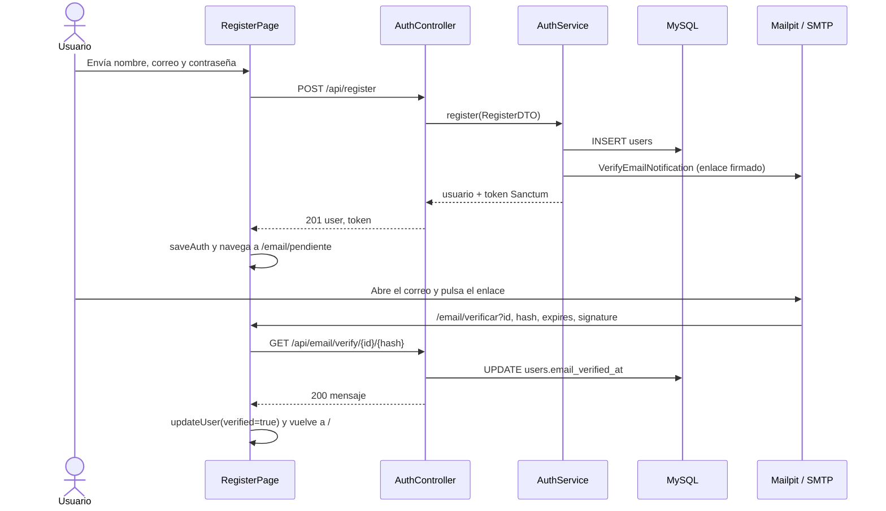
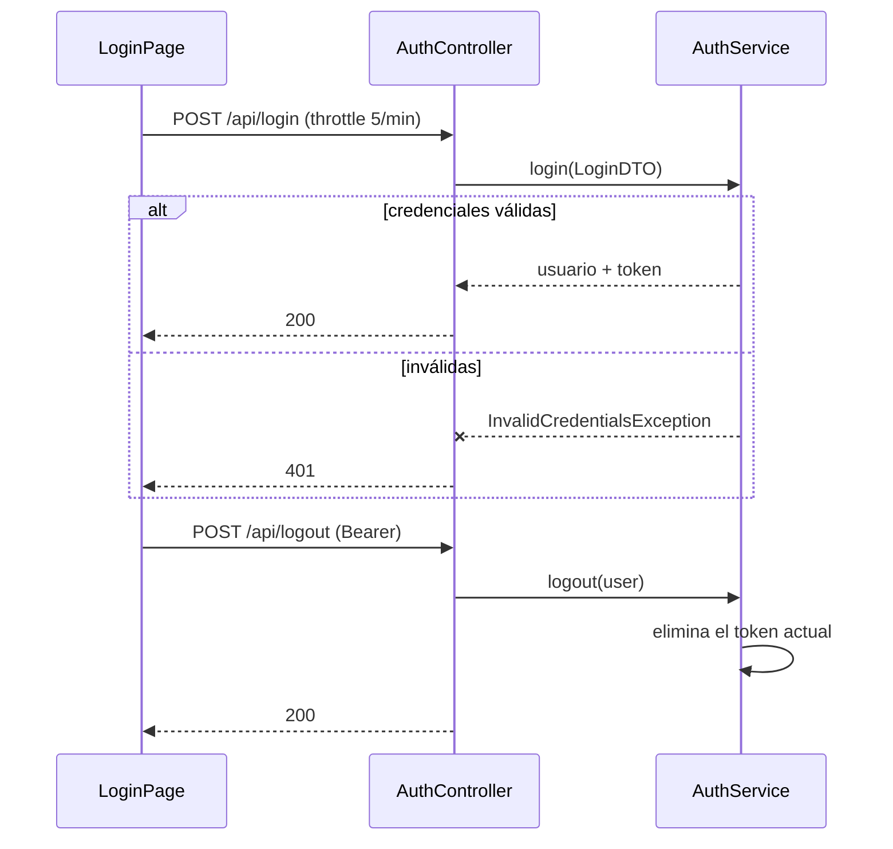

# Módulo 01 — Autenticación y verificación de correo

[Índice de módulos](README.md) · Siguiente: [02 Cartelera](02-cartelera.md)

Cubre el registro, el inicio y cierre de sesión con Sanctum y la verificación del correo. Quién puede comprar y por qué se exige correo verificado está en [reglas-de-negocio.md](../reglas-de-negocio.md); las tablas en [database-design.md](../database-design.md).

## Pantallas y navegación

| Ruta | Página | Guardia |
| --- | --- | --- |
| `/login` | `LoginPage` | `RedirectIfAuth` |
| `/registro` | `RegisterPage` | `RedirectIfAuth` |
| `/email/pendiente` | `EmailPendingPage` | `RequireAuth` |
| `/email/verificar` | `EmailVerifyPage` | ninguna (lee `id`, `hash`, `expires` y `signature` de la URL) |

Componentes de formulario compartidos en `components/auth/`: `AuthLayout`, `AuthField`, `FormAlert` y `SubmitButton`. Las guardias están en `components/guards/` (`RequireAuth`, `RequireVerified`, `RequireAdmin`, `RedirectIfAuth`); su uso en el árbol de rutas se describe en [frontend-architecture.md](../frontend-architecture.md).

## Estado de sesión

`AuthContext` guarda `user` y `loading`, y expone `saveAuth`, `clearAuth` y `updateUser`. El token vive en `localStorage` (`auth_token`) junto con el usuario (`auth_user`). El cliente Axios (`api/axios.js`) añade el encabezado `Authorization: Bearer` y reacciona a dos respuestas:

| Respuesta de la API | Efecto en el frontend |
| --- | --- |
| 401 | Borra token y usuario y emite el evento `auth:logout`; `App` limpia el contexto y navega a `/login` |
| 403 (salvo en `/email/verify`) | Emite `auth:unverified`; `App` navega a `/email/pendiente` |

## Flujo de registro y verificación

`VerifyEmailNotification` reemplaza la URL del enlace para que apunte a la ruta del SPA `/email/verificar` en lugar de a la API.

## Flujo de login y logout

## Endpoints

| Método y ruta | Acceso | Límite | Respuestas |
| --- | --- | --- | --- |
| `POST /register` | público | — | 201, 422 |
| `POST /login` | público | 5 por minuto | 200, 401, 422, 429 |
| `POST /logout` | `auth:sanctum` | — | 200, 401 |
| `POST /email/verification-notification` | `auth:sanctum` | 6 por minuto | 200 (enviado), 204 (ya verificado) |
| `GET /email/verify/{id}/{hash}` | `auth:sanctum` + `signed` | 6 por minuto | 200, 403 (firma inválida o expirada) |

Esquemas de petición y respuesta: [api-endpoints.md](../api-endpoints.md).

## Piezas del backend

| Capa | Archivo |
| --- | --- |
| Controladores | `Auth/AuthController`, `Auth/EmailVerificationController` |
| Validación | `Requests/Auth/RegisterRequest`, `LoginRequest` |
| DTO | `DTOs/Auth/RegisterDTO`, `LoginDTO` |
| Servicio | `Services/AuthService` |
| Modelo | `Models/User` (`MustVerifyEmail`, `HasApiTokens`) |
| Notificación | `Notifications/VerifyEmailNotification` |
| Excepción | `Exceptions/InvalidCredentialsException` |
| Resource | `Resources/UserResource` (`id`, `name`, `email`, `role`) |
| Middleware | alias `role` (`EnsureIsAdmin`) registrado en `bootstrap/app.php` y `verified` de Laravel |

## Niveles de acceso

| Grupo de rutas | Requiere | Ejemplos |
| --- | --- | --- |
| Públicas | nada | `GET /movies`, `GET /screenings/{id}` |
| `auth:sanctum` | token válido | `POST /logout`, verificación de correo |
| `auth:sanctum` + `verified` | token y correo verificado | `POST /purchases`, `GET /my-tickets` |
| `auth:sanctum` + `role:admin` | token y rol admin | `GET /admin/metrics` |
