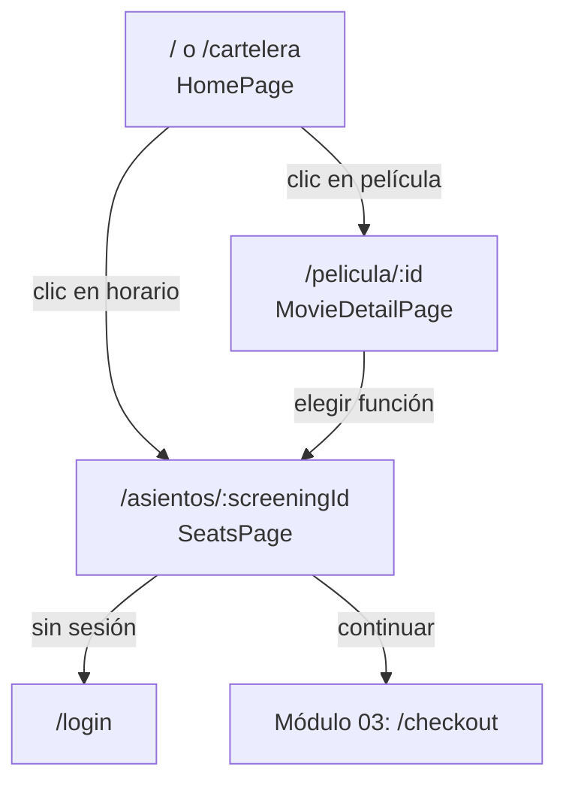
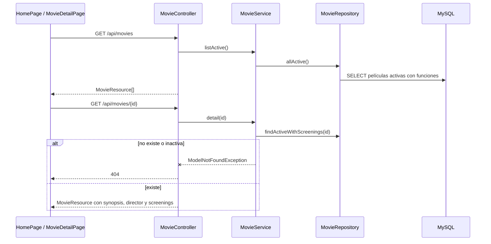

# Módulo 02 — Cartelera, detalle y mapa de asientos

[Índice de módulos](README.md) · Anterior: [01 Auth](01-auth.md) · Siguiente: [03 Compras](03-compras.md)

Cubre la consulta pública de películas y funciones. Qué películas y funciones se consideran disponibles está en [reglas-de-negocio.md](../reglas-de-negocio.md); las tablas `movies`, `rooms` y `screenings` en [database-design.md](../database-design.md).

## Pantallas

| Ruta | Página | Acceso |
| --- | --- | --- |
| `/` y `/cartelera` | `HomePage` | público; `/cartelera` desplaza hasta la sección `#cartelera` |
| `/pelicula/:id` | `MovieDetailPage` | público |
| `/asientos/:screeningId` | `SeatsPage` | `RequireVerified` (ver [módulo 03](03-compras.md)) |

## Componentes

| Componente | Uso |
| --- | --- |
| `home/HeroStage`, `HeroBackdrop`, `MovieMeta` | Destacado rotativo (5 películas al azar, cambio cada 8 s) |
| `home/GenreFilter` | Filtro por género en el cliente |
| `home/MovieRail`, `RailCard`, `ShowtimeChip` | Carriles de películas y chips de horario |
| `movie/MovieHeader`, `ShowtimePicker`, `showtimes.js` | Cabecera del detalle y selector de funciones agrupadas |
| `ui/Spinner`, `PillButton` | Estados de carga y acciones |

`HomePage` hace una sola petición (`getMovies`) y deriva destacado y filtros de esa respuesta; no pide el detalle de cada película. `MovieDetailPage` guarda la película en `BookingContext` antes de continuar.

## Flujo de datos

El mapa de asientos de una función sigue el mismo camino por `ScreeningController`, `ScreeningService.getSeatMap` y el repositorio de funciones; devuelve 404 si la función no está disponible.

## Endpoints

| Método y ruta | Acceso | Controlador | Contenido de la respuesta |
| --- | --- | --- | --- |
| `GET /movies` | público | `Movie/MovieController@index` | `id`, `title`, `genre`, `duration_minutes`, `rating`, `poster_url`, `status` y funciones |
| `GET /movies/{id}` | público | `Movie/MovieController@show` | Lo anterior más `synopsis` y `director` |
| `GET /screenings/{id}` | público | `Screening/ScreeningController@show` | Función, sala (`total_seats`, `available_seats`) y asientos ocupados |

Esquemas completos: [api-endpoints.md](../api-endpoints.md).

## Piezas del backend

| Capa | Archivo |
| --- | --- |
| Controladores | `Movie/MovieController`, `Screening/ScreeningController` |
| Servicios | `Services/MovieService`, `Services/ScreeningService` |
| Repositorios | `Contracts/MovieRepositoryInterface`, `ScreeningRepositoryInterface` y sus implementaciones en `Eloquent/` |
| Modelos | `Movie`, `Screening`, `Room` |
| Resources | `MovieResource`, `ScreeningResource` |
