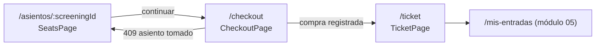
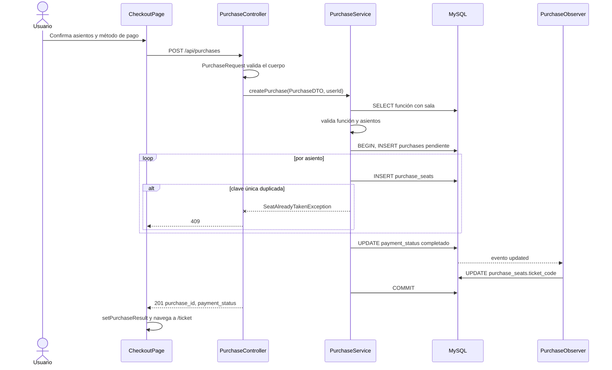
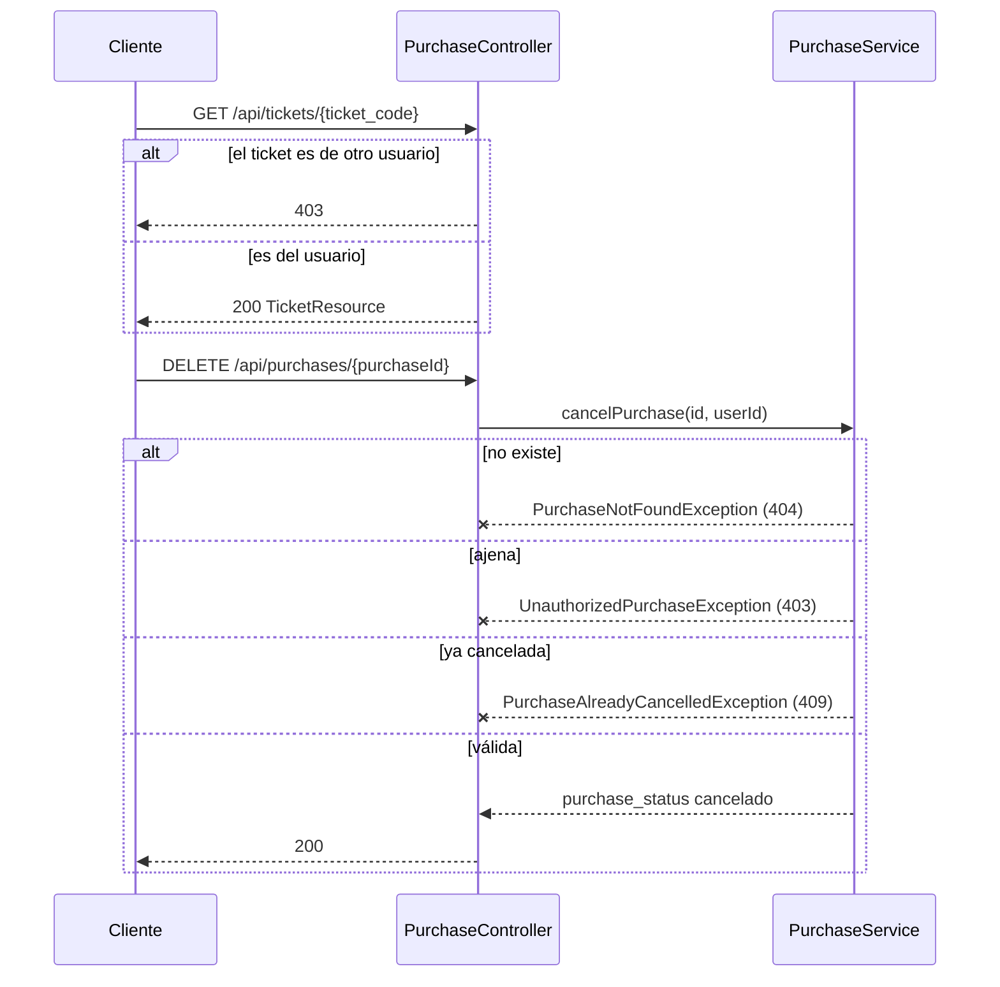

# Módulo 03 — Compras y ticket

[Índice de módulos](README.md) · Anterior: [02 Cartelera](02-cartelera.md) · Siguiente: [04 Admin](04-admin.md)

Cubre la selección de asientos, el checkout, la pantalla del ticket y la cancelación. Límites de asientos, precios, estados y cuándo se genera el `ticket_code` están en [reglas-de-negocio.md](../reglas-de-negocio.md); las restricciones únicas que evitan la doble reserva, en [database-design.md](../database-design.md).

## Pantallas y estado

| Ruta | Página | Guardia |
| --- | --- | --- |
| `/asientos/:screeningId` | `SeatsPage` | `RequireVerified` |
| `/checkout` | `CheckoutPage` | `RequireVerified` |
| `/ticket` | `TicketPage` | `RequireAuth` |

`BookingContext` conserva entre pantallas `selectedMovie`, `selectedSchedule`, `selectedSeats` y `purchaseResult`. `TicketPage` lee `purchaseResult` de ese contexto; sin él muestra un estado vacío con enlaces a la cartelera y a Mis entradas.

| Componente | Uso |
| --- | --- |
| `seats/SeatMap`, `seatLook.js` | Cuadrícula de asientos y su apariencia por estado |
| `QRCode` | Código QR del ticket |
| `tickets/Poster`, `tickets.js` | Cartel y utilidades de formato de boletos |
| `ui/BtnPrimary`, `PillButton` | Acciones |

El checkout ofrece los métodos `cash` y `card`; la API además acepta `online`.

## Flujo de compra

Si el INSERT lanza el error de clave duplicada, se revierte toda la transacción y el frontend regresa a `SeatsPage` con un aviso.

## Consulta de un ticket y cancelación

El frontend actual no ofrece un botón de cancelación: el endpoint existe pero ninguna pantalla lo invoca.

## Endpoints

Todos exigen `auth:sanctum` y `verified`.

| Método y ruta | Controlador | Respuestas |
| --- | --- | --- |
| `POST /purchases` | `Purchase/PurchaseController@store` | 201, 404 (función), 409 (asiento tomado o función no disponible), 422 |
| `DELETE /purchases/{purchaseId}` | `@cancel` | 200, 403, 404, 409 |
| `GET /tickets/{ticket_code}` | `@showTicket` | 200, 403, 404 |

Esquemas: [api-endpoints.md](../api-endpoints.md).

## Piezas del backend

| Capa | Archivo |
| --- | --- |
| Controlador | `Purchase/PurchaseController` |
| Validación y DTO | `Requests/Purchase/PurchaseRequest`, `DTOs/Purchase/PurchaseDTO` |
| Servicio | `Services/PurchaseService` |
| Repositorio | `PurchaseRepositoryInterface` y su implementación Eloquent |
| Observer | `Observers/PurchaseObserver` (asigna `ticket_code`) |
| Modelos | `Purchase`, `PurchaseSeat` |
| Resources | `PurchaseResource`, `TicketResource` |
| Excepciones | `ScreeningNotAvailableException`, `InvalidSeatException`, `SeatAlreadyTakenException`, `PurchaseNotFoundException`, `UnauthorizedPurchaseException`, `PurchaseAlreadyCancelledException` |
