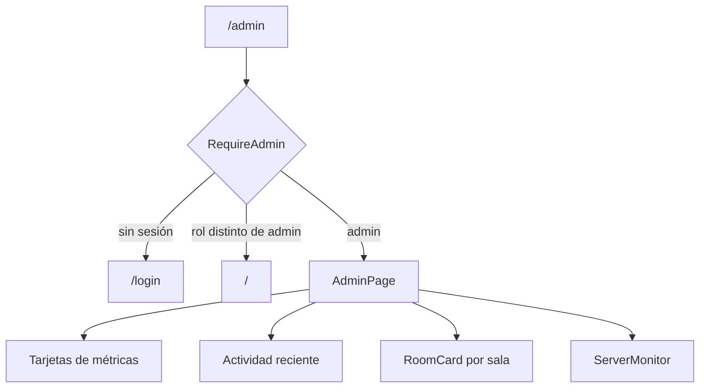
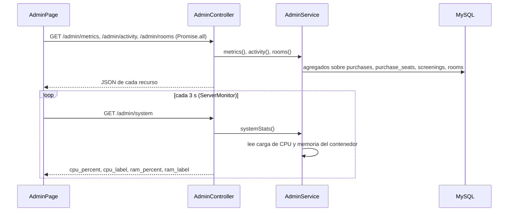

# Módulo 04 — Administración

[Índice de módulos](README.md) · Anterior: [03 Compras](03-compras.md) · Siguiente: [05 Mis entradas](05-mis-entradas.md)

Panel de solo lectura para el rol `admin`: métricas de ventas, actividad reciente, estado de las salas y consumo del servidor. Cómo se calculan ventas, ocupación y estados de sala está en [reglas-de-negocio.md](../reglas-de-negocio.md); las tablas en [database-design.md](../database-design.md).

## Pantalla y acceso

| Ruta | Página | Guardia |
| --- | --- | --- |
| `/admin` | `AdminPage` | `RequireAdmin` (comprueba `user.role`) |

`AdminPage` sigue con estilos del sistema anterior (`constants/theme.js`) y define internamente `MetricCard`, `ActivityDot`, `RoomCard`, `SegmentedBar` y `ServerMonitor`. La guardia del cliente es solo comodidad: la autorización real la aplica el middleware `role:admin` del backend.

| Estado de `RoomCard` | Contenido |
| --- | --- |
| `showing` | Película actual, tiempo restante, próxima función y barra de ocupación |
| `upcoming` | Próxima película, hora de inicio, cuenta atrás y ocupación |
| `idle` | Mensaje de sin funciones programadas |

## Carga de datos

Las tres primeras peticiones se hacen una vez al montar la página; solo `ServerMonitor` consulta periódicamente.

## Endpoints

Todos exigen `auth:sanctum` y `role:admin` (403 si el rol es otro).

| Método y ruta | Método de `AdminService` | Contenido |
| --- | --- | --- |
| `GET /admin/metrics` | `metrics` | `tickets_sold`, `daily_sales`, `registered_users`, `top_movie`, `weekly_sales` (Lun a Dom) |
| `GET /admin/activity` | `activity` | Hasta 20 eventos mezclados de compras completadas y pagos fallidos, con `type`, `message` y `time` relativo |
| `GET /admin/rooms` | `rooms` | Por sala: `room`, `status`, película actual, fin, ocupación y próxima función |
| `GET /admin/system` | `systemStats` | `cpu_percent`, `cpu_label`, `ram_percent`, `ram_label` |

Esquemas: [api-endpoints.md](../api-endpoints.md).

## Piezas

| Capa | Archivo |
| --- | --- |
| Frontend | `pages/AdminPage.jsx`, `api/admin.js` (`getAdminMetrics`, `getAdminActivity`, `getAdminRooms`, `getAdminSystem`) |
| Controlador | `Admin/AdminController` |
| Servicio | `Services/AdminService` |
| Middleware | `Http/Middleware/EnsureIsAdmin` (alias `role`) |
| Rutas | `routes/api.php`, grupo con prefijo `admin` |
| Modelos | `Purchase`, `PurchaseSeat`, `Screening`, `Room`, `Movie`, `User` |
