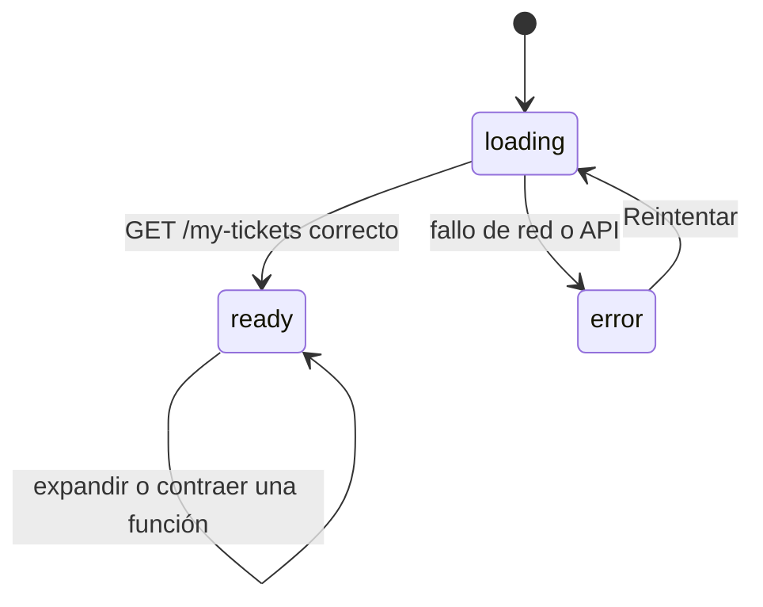
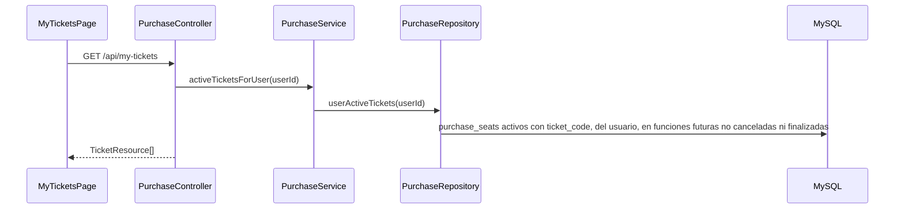

# Módulo 05 — Mis entradas

[Índice de módulos](README.md) · Anterior: [04 Admin](04-admin.md) · Siguiente: [06 Demo](06-demo.md)

Listado de los boletos vigentes del usuario autenticado. Qué boletos se consideran vigentes está en [reglas-de-negocio.md](../reglas-de-negocio.md).

## Pantalla

| Ruta | Página | Guardia |
| --- | --- | --- |
| `/mis-entradas` | `MyTicketsPage` | `RequireAuth` |

La página agrupa los asientos por función (`groupByScreening`), muestra una tarjeta por función con un QR por asiento y actualiza cada minuto la cuenta regresiva. La primera tarjeta del filtro activo aparece expandida. Los estados vacío y de error usan el componente local `CenteredState`. Utilidades compartidas con el ticket: `tickets/Poster`, `tickets/tickets.js` y `QRCode`.

## Flujo de datos

## Endpoint

| Método y ruta | Acceso | Respuesta |
| --- | --- | --- |
| `GET /my-tickets` | `auth:sanctum` + `verified` | 200 con una lista de `TicketResource`: `ticket_code`, `status`, `movie_title`, `poster_url`, `start_time`, `format`, `language_type`, `room`, `row`, `seat_number`, `price_paid`, `user_name`, `purchased_at` |

Esquema: [api-endpoints.md](../api-endpoints.md). El detalle de un solo ticket (`GET /tickets/{ticket_code}`) pertenece al [módulo 03](03-compras.md).
