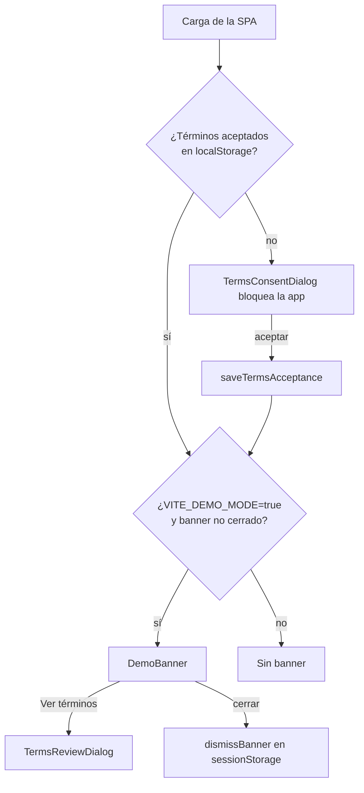
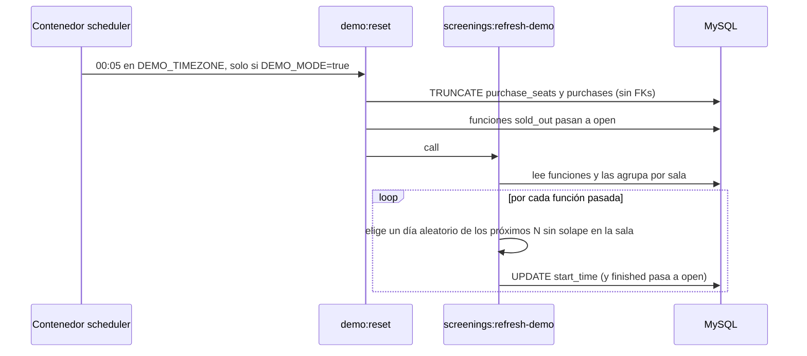

# Módulo 06 — Modo demostración y scheduler

[Índice de módulos](README.md) · Anterior: [05 Mis entradas](05-mis-entradas.md)

El entorno publicado funciona como simulación: no hay pagos reales y los datos se reinician cada noche. Aquí se describe el aviso en el frontend y los comandos programados del backend. Qué se borra y qué se conserva está en [reglas-de-negocio.md](../reglas-de-negocio.md); el contenedor `scheduler` en [deployment-produccion.md](../deployment-produccion.md).

## Aviso en el frontend

| Pieza | Responsabilidad |
| --- | --- |
| `components/TermsDialog` | `TermsConsentDialog` (primera visita) y `TermsReviewDialog` (consulta posterior) |
| `components/DemoBanner` | Aviso flotante y cerrable de entorno de demostración |
| `utils/simulationNotice.js` | Lectura y escritura tolerante a fallos del almacenamiento: clave de términos versionada (`v1`; cambiarla obliga a aceptar de nuevo) y clave del banner |
| Variable `VITE_DEMO_MODE` | Activa el banner en el build del frontend |

## Reinicio diario

| Comando | Opciones | Efecto |
| --- | --- | --- |
| `demo:reset` | `--force` ejecuta aunque `DEMO_MODE` no esté activo | Vacía compras y boletos, reabre funciones agotadas y reagenda las pasadas; conserva usuarios, sesiones y tokens |
| `screenings:refresh-demo` | `--days=7` ventana de reparto | Mueve cada función pasada a un día aleatorio de la ventana evitando solapes en la misma sala |

La programación se registra en `routes/console.php` solo si `config('app.demo_mode')` es verdadero, con `withoutOverlapping`. Cuentas de administrador y variables de entorno: [deployment-produccion.md](../deployment-produccion.md).

## Piezas del backend

| Capa | Archivo |
| --- | --- |
| Comandos | `Console/Commands/ResetDemoData`, `Console/Commands/RefreshDemoScreenings` |
| Programación | `routes/console.php` |
| Pruebas | `tests/Feature/ResetDemoDataTest`, `RefreshDemoScreeningsTest` |
