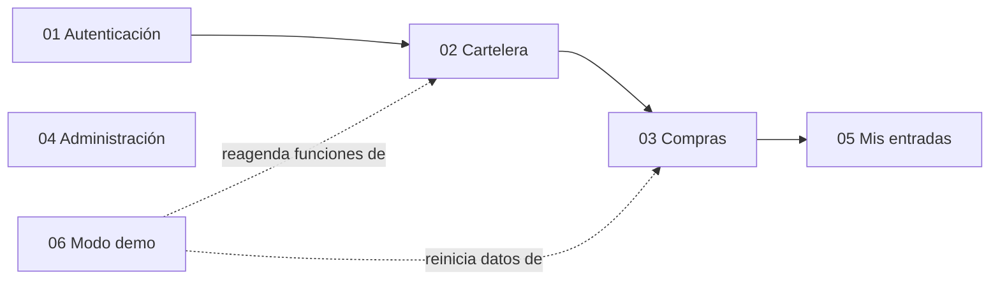

# Módulos — Cine Sendera

Cada archivo describe un módulo funcional de extremo a extremo: pantallas y componentes del frontend, endpoints, controlador, servicio y tablas implicadas. Las reglas de negocio no se repiten aquí: viven en [reglas-de-negocio.md](../reglas-de-negocio.md).

| Módulo | Cubre | Endpoints |
| --- | --- | --- |
| [01-auth.md](01-auth.md) | Registro, login, logout y verificación de correo | `POST /register`, `POST /login`, `POST /logout`, `POST /email/verification-notification`, `GET /email/verify/{id}/{hash}` |
| [02-cartelera.md](02-cartelera.md) | Cartelera, detalle de película y mapa de asientos | `GET /movies`, `GET /movies/{id}`, `GET /screenings/{id}` |
| [03-compras.md](03-compras.md) | Selección de asientos, checkout, ticket y cancelación | `POST /purchases`, `DELETE /purchases/{purchaseId}`, `GET /tickets/{ticket_code}` |
| [04-admin.md](04-admin.md) | Panel de administración | `GET /admin/metrics`, `/admin/activity`, `/admin/rooms`, `/admin/system` |
| [05-mis-entradas.md](05-mis-entradas.md) | Listado de boletos del usuario | `GET /my-tickets` |
| [06-demo.md](06-demo.md) | Modo demostración, aviso legal y scheduler | Comandos `demo:reset` y `screenings:refresh-demo` |

## Documentos de referencia

| Documento | Contenido |
| --- | --- |
| [reglas-de-negocio.md](../reglas-de-negocio.md) | Reglas de negocio (fuente única) |
| [database-design.md](../database-design.md) | Esquema de base de datos |
| [api-endpoints.md](../api-endpoints.md) | Referencia completa de la API |
| [backend-architecture.md](../backend-architecture.md) | Capas, patrones y seguridad del backend |
| [frontend-architecture.md](../frontend-architecture.md) | Estructura, rutas y estado del frontend |
| [frontend-design-system.md](../frontend-design-system.md) | Paleta, tipografía y componentes base |
| [docker-entorno-desarrollo.md](../docker-entorno-desarrollo.md) | Entorno Docker de desarrollo |
| [deployment-produccion.md](../deployment-produccion.md) | Despliegue de producción simulado |

## Material académico

[examen-teorico-resumen-implementacion.md](../examen-teorico-resumen-implementacion.md) es el resumen teórico del parcial de contenedores y su memoria de implementación. No describe funcionalidad de la aplicación; se conserva como entrega académica.
