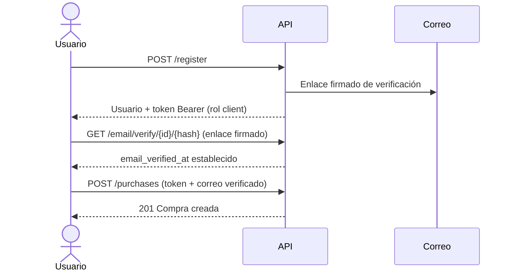
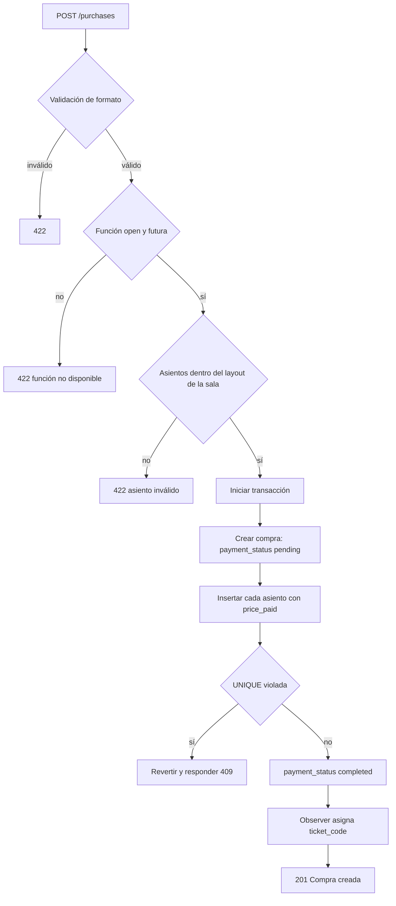
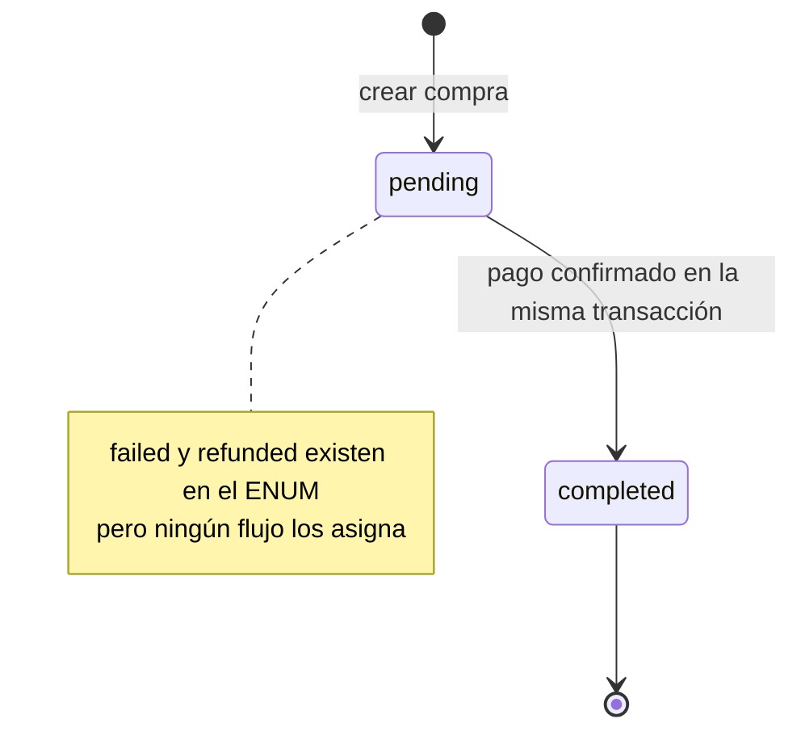
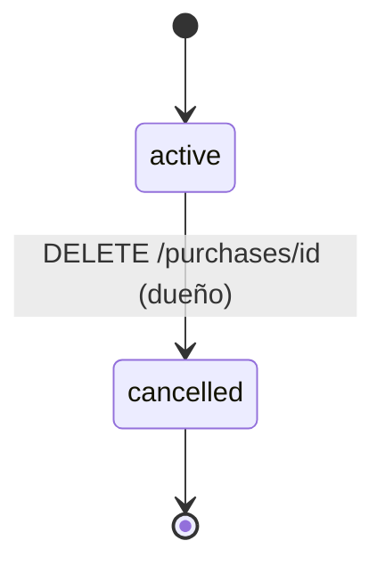
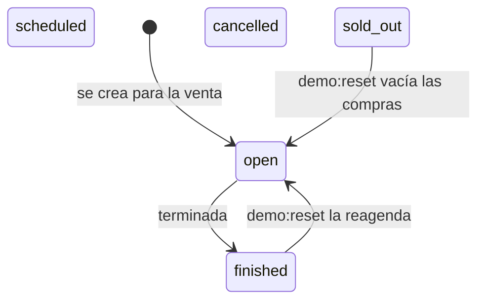
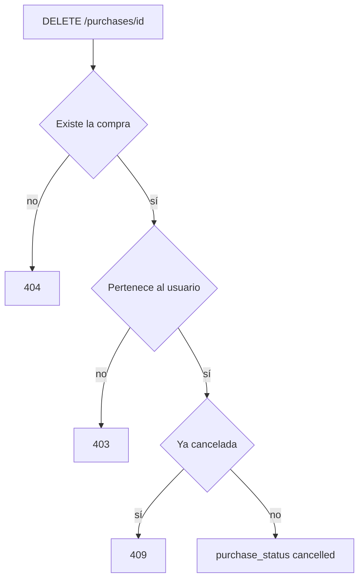
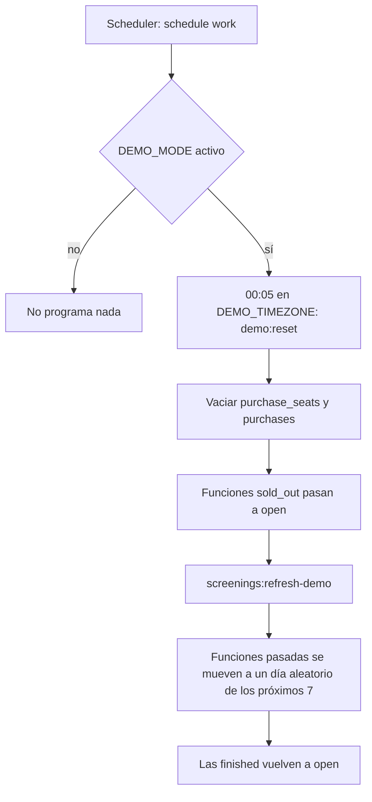

# Reglas de negocio — Cine Sendera

Fuente única de las reglas de negocio del sistema. Cada regla fue verificada contra el código (`backend/app`, `backend/routes`, `backend/database`). El esquema de datos está en [database-design.md](database-design.md); los demás documentos enlazan aquí en lugar de repetir las reglas.

## Contenido

- [Roles y permisos](#roles-y-permisos)
- [Autenticación y verificación de correo](#autenticación-y-verificación-de-correo)
- [Límite de peticiones](#límite-de-peticiones)
- [Visibilidad de la cartelera](#visibilidad-de-la-cartelera)
- [Flujo de compra](#flujo-de-compra)
- [Asientos y doble reserva](#asientos-y-doble-reserva)
- [Precio histórico](#precio-histórico)
- [Estados](#estados)
- [Tickets](#tickets)
- [Cancelación de compras](#cancelación-de-compras)
- [Desactivación sin borrado](#desactivación-sin-borrado)
- [Panel de administración](#panel-de-administración)
- [Modo demo](#modo-demo)
- [Discrepancias conocidas entre reglas y código](#discrepancias-conocidas-entre-reglas-y-código)

---

## Roles y permisos

`users.role` es un ENUM con tres valores: `admin`, `cashier` y `client` (por defecto). No existen Policies ni Gates: la autorización se resuelve con middleware de ruta y con comprobaciones de propiedad dentro de los Services y controladores.

| Nivel de acceso               | Middleware                       | Rutas                                                                                  |
| ----------------------------- | -------------------------------- | -------------------------------------------------------------------------------------- |
| Público                       | —                                | `POST /register`, `POST /login`, `POST /forgot-password`, `POST /reset-password`, `GET /movies`, `GET /movies/{id}`, `GET /screenings/{id}` |
| Autenticado                   | `auth:sanctum`                   | `POST /logout`, reenvío y verificación de correo                                       |
| Autenticado y correo verificado | `auth:sanctum` + `verified`    | `POST /purchases`, `DELETE /purchases/{id}`, `GET /my-tickets`, `GET /tickets/{ticket_code}` |
| Administrador                 | `auth:sanctum` + `role:admin`    | `GET /admin/metrics`, `/admin/activity`, `/admin/rooms`, `/admin/system`               |

Reglas de propiedad:

- Cancelar una compra y ver un ticket solo está permitido a su dueño (`purchases.user_id`); si no, responde `403`.
- El rol `cashier` existe en el esquema pero ninguna ruta lo distingue de `client` (ver [discrepancias](#discrepancias-conocidas-entre-reglas-y-código)).
- Todo registro público crea una cuenta `client`; el único administrador lo crea el seeder a partir de `ADMIN_EMAIL` y `ADMIN_PASSWORD` (ver [modo demo](#modo-demo)).

## Autenticación y verificación de correo

- La autenticación es con Sanctum (token Bearer). `login` y `register` emiten un token nuevo; `logout` elimina solo el token actual.
- El correo debe estar verificado (`email_verified_at`) para comprar, cancelar y ver tickets. Sin verificar, el middleware `verified` rechaza la petición.
- El enlace de verificación es firmado (`signed`) y exige estar autenticado. Si el correo ya estaba verificado, el reenvío responde `204` y la verificación responde un mensaje informativo.
- Validación de registro: nombre de 2 a 255 caracteres con algún carácter visible, correo único, contraseña de 8 a 72 caracteres con confirmación.
- El administrador del seeder se crea con el correo ya verificado.

### Recuperación de contraseña

- `POST /forgot-password` acepta un correo y envía un enlace de restablecimiento al frontend (`{FRONTEND_URL}/reset-password?token={token}&email={email}`). Responde siempre con un mensaje genérico de éxito para no revelar si el correo existe.
- `POST /reset-password` valida el token, el correo y la nueva contraseña (mismas reglas que el registro: 8–72 caracteres con confirmación). Si el token es válido, actualiza la contraseña e invalida el `remember_token`.
- Ambas rutas están limitadas a 5 peticiones por minuto.
- El enlace de restablecimiento expira según `auth.passwords.users.expire` (por defecto 60 minutos).

## Límite de peticiones

| Ruta                                   | Límite                |
| -------------------------------------- | --------------------- |
| `POST /login`                          | 5 por minuto          |
| `POST /forgot-password`               | 5 por minuto          |
| `POST /reset-password`                | 5 por minuto          |
| `POST /email/verification-notification` | 6 por minuto         |
| `GET /email/verify/{id}/{hash}`        | 6 por minuto          |

## Visibilidad de la cartelera

| Recurso                       | Condición para mostrarse                                                                                              |
| ----------------------------- | --------------------------------------------------------------------------------------------------------------------- |
| Lista de películas            | `movies.status = 'active'` y al menos una función futura (`start_time` posterior a ahora) que no esté `cancelled` ni `finished` |
| Detalle de película           | Igual que lo anterior; solo se listan sus funciones futuras no canceladas ni finalizadas                              |
| Mapa de asientos de función   | La función es futura y no está `cancelled` ni `finished`; si no, responde `404`                                       |
| Asientos ocupados             | Los `purchase_seats` con `status = 'active'`                                                                          |

El mapa de asientos se calcula a partir de `rooms.rows` y `rooms.seats_per_row`: no existe tabla `seats`. La capacidad es `rows × seats_per_row`.

## Flujo de compra

- Formato: `screening_id` existente, al menos un asiento, `row` de una letra A-Z, `seat_number` entre 1 y 30, `payment_method` en `cash`, `card` u `online`.
- Solo se puede comprar una función con `status = 'open'` cuya `start_time` aún no pasó.
- Asiento válido: la fila debe estar entre `A` y la letra que corresponde a `rooms.rows`, y el número entre 1 y `rooms.seats_per_row`. La fila se normaliza a mayúscula.
- `total_amount` es la cantidad de asientos por `screenings.base_price`.
- El pago es simulado: la compra nace `pending` y pasa a `completed` dentro de la misma transacción. Ninguna ruta produce hoy `failed` ni `refunded`.
- No hay límite de asientos por compra más allá del tamaño de la sala.

## Asientos y doble reserva

La garantía es la restricción `UNIQUE (screening_id, row, seat_number)` en `purchase_seats`.

- No se hace una comprobación previa de existencia: dos transacciones concurrentes podrían pasarla y colisionar al insertar.
- Se inserta directamente dentro de `DB::transaction()` y se captura la excepción de clave duplicada (`UniqueConstraintViolationException`), que se traduce en `SeatAlreadyTakenException` (`409`) y revierte toda la compra.
- Un asiento libre es simplemente uno que no aparece en `purchase_seats` para esa función; no hay filas de asientos libres.
- La restricción cubre filas con cualquier `status`: un asiento cuya fila queda `cancelled` sigue bloqueando la combinación (ver [cancelación](#cancelación-de-compras)).

## Precio histórico

`purchase_seats.price_paid` guarda el precio de `screenings.base_price` vigente al comprar. Nunca se recalcula a partir de la función para compras pasadas, de modo que un cambio de tarifa no altera el historial.

## Estados

### Compra

`purchase_status` es independiente de `payment_status`:

### Función

- Solo `open` permite comprar. Ningún código asigna automáticamente `sold_out`, `scheduled`, `cancelled` ni `finished`: son valores administrados por datos (seed o edición manual). Ver [discrepancias](#discrepancias-conocidas-entre-reglas-y-código).
- El panel de salas considera las funciones `scheduled`, `open` y `sold_out`.

### Asiento comprado

`purchase_seats.status`: `active` (por defecto), `cancelled` y `used`. Solo `active` cuenta como ocupado en el mapa de asientos y en las métricas.

## Tickets

- No existe tabla `tickets`: el ticket es la fila de `purchase_seats` y su `ticket_code`.
- `ticket_code` es un UUID asignado por `PurchaseObserver` al detectar que `payment_status` cambió a `completed`; nunca se genera en la petición de compra. Es `UNIQUE` y `NULL` mientras el pago no se confirma.
- El QR se genera en el cliente a partir del `ticket_code`; no se persiste.
- `GET /my-tickets` lista los asientos con `status = 'active'`, con `ticket_code`, de compras del usuario cuya función es futura y no está `cancelled` ni `finished`. Un ticket por asiento.
- `GET /tickets/{ticket_code}` devuelve el detalle solo a su dueño (`403` en otro caso, `404` si no existe).

## Cancelación de compras

- Solo el dueño puede cancelar; ni siquiera `admin` tiene una ruta para cancelar compras ajenas.
- Hoy la cancelación solo cambia `purchases.purchase_status`. No marca `purchase_seats.status = 'cancelled'`, no libera los asientos y no revoca los tickets (ver [discrepancias](#discrepancias-conocidas-entre-reglas-y-código)).
- No se valida un plazo ni que la función no haya empezado.

## Desactivación sin borrado

- No hay soft deletes: no existe `deleted_at` en ninguna tabla.
- Para ocultar una película se usa `movies.status = 'inactive'` (o `coming_soon`): deja de aparecer en la cartelera pero conserva su historial de compras.
- `users.status` admite `inactive`, pero el login no lo comprueba. Solo se usa para contar usuarios activos en las métricas.
- `rooms.status = 'maintenance'` excluye la sala del panel de salas; no impide por sí mismo vender funciones de esa sala.

## Panel de administración

Todas las rutas exigen `role:admin`. Reglas de cálculo:

| Métrica                | Regla                                                                                         |
| ---------------------- | --------------------------------------------------------------------------------------------- |
| Tickets vendidos       | Conteo de `purchase_seats` con `status = 'active'`                                            |
| Ventas del día         | Suma de `total_amount` de compras `completed` creadas hoy                                     |
| Usuarios registrados   | Conteo de `users` con `status = 'active'`                                                     |
| Película más vista     | Película con más `purchase_seats` activos                                                     |
| Ventas semanales       | Cantidad de compras `completed` por día de la semana en curso                                 |
| Actividad              | Últimas 10 compras `completed` (éxito) y 10 `failed` (error), ordenadas por `updated_at`       |
| Estado de salas        | `showing` si hay función en curso (inicio + duración), `upcoming` si hay una próxima, `idle` en otro caso; la ocupación se mide contra la función en curso o, si no hay, la próxima |

## Modo demo

El entorno de simulación (pre) conserva los usuarios registrados y reinicia las compras cada día.

- `demo:reset` se niega a ejecutarse sin `DEMO_MODE`, salvo con `--force`.
- Al reagendar se prefiere un día en que la sala no se solape con otra función; si ninguno está libre, se usa el primero sorteado. Se conserva la hora original.
- La cuenta de administrador sale de `ADMIN_EMAIL` y `ADMIN_PASSWORD` mediante `DatabaseSeeder`, que corre en cada arranque del contenedor `app`. En desarrollo hay valores por defecto (`test@example.com` / `password`); en producción, sin esas variables no se crea ningún administrador.
- Despliegue y programación del scheduler: [deployment-servidor-personal.md](deployment-servidor-personal.md).

## Discrepancias conocidas entre reglas y código

Reglas documentadas antes (en `CLAUDE.md`, `database-design.md` o la arquitectura) que el código actual no cumple, y reglas descartadas:

| Regla anterior                                                                 | Estado real                                                                                                   |
| ------------------------------------------------------------------------------ | ------------------------------------------------------------------------------------------------------------- |
| Cancelar actualiza también `purchase_seats.status = 'cancelled'`               | No se cumple: solo cambia `purchase_status`. Los asientos siguen ocupados y los tickets activos                |
| Función pasa a `sold_out` al llenarse la sala                                  | No implementado: ningún código la asigna; solo `demo:reset` la revierte                                       |
| `lockForUpdate()` junto con la transacción                                     | Descartada: no se usa; basta el `INSERT` con captura de la violación `UNIQUE`                                 |
| Autorización con Policies por modelo                                           | No existen Policies; hay middleware (`verified`, `role:admin`) y comprobaciones de propiedad en el servicio    |
| Roles diferenciados (`cashier`)                                                | Aplazado intencionalmente: no hay requisitos de negocio definidos. El valor permanece en el ENUM para no requerir una migración destructiva; se implementará cuando se definan sus permisos |
| Usuario `inactive` pierde acceso                                               | No se comprueba en login ni en middleware                                                                      |
| Índice de historial de compras ordenado de forma descendente                   | La migración crea `(user_id, created_at)` ascendente                                                          |
| `payment_status` `failed` y `refunded`                                         | Definidos en el ENUM pero sin flujo que los asigne; el panel solo lee `failed`                                 |
| `GET /tickets/{code}` solo con compras vigentes                                | No se valida `purchase_status` ni `status` del asiento al consultar un ticket por código                       |
| `ticket_code` con formato de código legible                                    | Es un UUID                                                                                                     |
